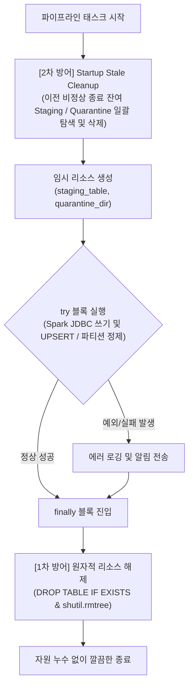

# 8회차 과제: 파이프라인 장애 복구 및 리소스 누수 방어
> **PostgreSQL Staging 테이블 및 파일시스템 Quarantine 디렉토리의 생명주기 관리와 `try ... finally` 기반 자원 정리 설계**

---

## 1. 개요 및 배경 (Background & Problem)

Amazon 리뷰 수집·정제·마트 적재 파이프라인(Airflow + Spark + PostgreSQL)은 대용량 데이터를 다루는 분산 배치 시스템입니다. 대규모 배치 파이프라인에서는 **Spark Worker OOM, 네트워크 순단, 데이터 스키마 이상, 컨테이너 비정상 종료(SIGKILL)** 등 다양한 원인으로 작업이 중간에 실패할 수 있습니다.

기존 파이프라인에서는 다음과 같은 **자원 누수(Resource Leak) 및 스토리지 잠식 문제**가 발생했습니다:

### ① PostgreSQL Staging 임시 테이블 누적 문제
- **발생 위치**: `jobs/product_analytics.py`, `jobs/sentiment_analysis.py`, `jobs/refine_reviews.py`
- **현상**:
  - Spark에서 생성된 대량 집계 데이터를 대상 마트 테이블에 원자적 `UPSERT`하기 위해 난수 기반 스테이징 테이블(`product_monthly_metrics_staging_{run_id}`, `product_sentiment_monthly_staging_{run_id}` 등)을 임시 생성하여 적재합니다.
  - 그러나 Spark JDBC 쓰기 중간에 오류가 나거나, UPSERT SQL 실행 중 예외가 발생하면 트랜잭션이 롤백되면서 마지막 `DROP TABLE` 명령에 도달하지 못했습니다.
  - 실행마다 고유한 `run_id`가 부여되므로, 태스크 실패 및 재시도가 반복될 때마다 **미정리 스테이징 테이블이 PostgreSQL 데이터베이스에 무한정 누적**되어 카탈로그 메타데이터와 디스크 용량을 낭비했습니다.

### ② 파일시스템 Quarantine(격리) 디렉토리 방치 문제
- **발생 위치**: `jobs/refine_reviews.py` (`data/processed/`, `data/raw_parquet/`)
- **현상**:
  - 파티션 무결성 검증(`_manifest.json`, `_SUCCESS`) 실패 또는 원자적 교체(Swap) 에러 시, 불완전한 데이터가 정상 서비스 경로에 노출되지 않도록 `._quarantine_*` 또는 `{category}._quarantine_all_{run_id}` 디렉토리로 격리시킵니다.
  - 기존에는 staging 디렉토리 정리 로직만 존재하고 **quarantine 디렉토리를 정리하는 로직이 없어**, 한 번 격리된 대용량 Parquet 폴더(예: `2x_All_Beauty._quarantine_all_c1dfbe55`)가 영구히 남아 로컬 디스크 스토리지를 고갈시키는 위험이 존재했습니다.

---

## 2. 해결 아키텍처: 2중 방어선 설계 (Two-Layer Defense)

이 문제를 근본적으로 해결하기 위해 **런타임 자동 정리(1차)**와 **프로세스 기동 시 잔여물 정리(2차)**로 이루어진 2중 방어 아키텍처를 구축했습니다.



1. **1차 방어선 (`try ... finally` 블록)**:
   - 태스크 중간에 Spark 에러, DB 제약조건 위반, Python 예외가 발생하더라도 언어 런타임 차원에서 `finally` 실행을 보장하여 임시 테이블 및 격리 디렉토리를 즉시 삭제.
2. **2차 방어선 (Startup Stale Cleanup)**:
   - Docker 컨테이너 강제 종료(`kill -9`, OOM Killer) 등 인터프리터 수준의 `finally`조차 실행되지 못하고 프로세스가 급작스럽게 증발한 경우를 대비하여, **다음 태스크 실행 시작 시점에 이전 잔여 Staging 테이블과 Quarantine 폴더를 선제적으로 일괄 삭제**.

---

## 3. 세부 구현 내용 (Implementation Details)

### 3.1. PostgreSQL Staging 테이블 생명주기 관리

#### (1) 공통 안전 삭제 및 잔여 테이블 정리 유틸리티
원래 발생한 비즈니스 에러를 덮어쓰지(mask) 않도록 단독 커넥션과 트랜잭션으로 격리하여 안전하게 실행합니다.

```python
def drop_table_if_exists(db_config, table_name):
    """PostgreSQL 테이블이 존재할 경우 안전하게 삭제합니다."""
    try:
        import psycopg2
        conn = psycopg2.connect(**db_config)
        try:
            with conn.cursor() as cur:
                cur.execute(f"DROP TABLE IF EXISTS {table_name};")
            conn.commit()
            print(f"[Staging 정리] 임시 테이블 삭제 완료: {table_name}", flush=True)
        finally:
            conn.close()
    except Exception as e:
        print(f"[Staging 정리 경고] {table_name} 삭제 중 오류 (무시됨): {e}", flush=True)


def cleanup_stale_staging_tables(db_config, prefixes):
    """이전 비정상 종료로 남겨진 stale staging 테이블들을 information_schema에서 조회하여 일괄 정리합니다."""
    try:
        import psycopg2
        conn = psycopg2.connect(**db_config)
        try:
            with conn.cursor() as cur:
                for prefix in prefixes:
                    cur.execute(
                        "SELECT table_schema, table_name FROM information_schema.tables WHERE table_name LIKE %s;",
                        (f"{prefix}%",),
                    )
                    stale_tables = cur.fetchall()
                    for schema, tbl in stale_tables:
                        full_name = f'"{schema}"."{tbl}"' if schema else tbl
                        cur.execute(f"DROP TABLE IF EXISTS {full_name};")
                        print(f"[시작 정리] 이전 실패 잔여 staging 테이블 삭제: {full_name}", flush=True)
            conn.commit()
        finally:
            conn.close()
    except Exception as e:
        print(f"[Staging 시작 정리 경고] 잔여 staging 테이블 조회/삭제 중 오류: {e}", flush=True)
```

#### (2) 각 작업 스크립트별 `try ... finally` 적용
* **`jobs/product_analytics.py`**:
  * 월별 지표 마트 적재: `product_monthly_metrics_staging_{run_id}`
  * 저리뷰 vs 다리뷰 세그먼트 적재: `product_segment_comparison_staging_{run_id}`
  * 적재 및 UPSERT 전체 구간을 `try ... finally`로 묶어 실패 시에도 `drop_table_if_exists()` 호출 보장 및 캐시 메모리(`unpersist()`) 해제.
* **`jobs/sentiment_analysis.py`**:
  * 감정 요약 적재: `product_sentiment_monthly_staging_{run_id}`
  * 이상 리뷰 적재: `product_sentiment_anomalies_staging_{run_id}`
  * 두 적재 단계 각각 `try ... finally`로 격리하여 이상 리뷰 적재 중 오류가 발생해도 앞서 생성된 요약 스테이징 테이블이 잔여물 없이 정리되도록 보장.
* **`jobs/refine_reviews.py`**:
  * 월별 요약 집계 단계(`aggregate_monthly`): `monthly_review_summary_staging` 적재 및 UPSERT를 `try ... finally`로 감싸 스테이징 테이블 정리 보장.

---

### 3.2. 파일시스템 Quarantine 디렉토리 수명주기 관리

#### (1) Quarantine 디렉토리 전용 정리 함수 추가 (`jobs/refine_reviews.py`)
```python
def cleanup_stale_quarantine(processed_dir, target_ym=None):
    """이전 실패로 남겨진 월별 파티션 격리(quarantine) 디렉터리들을 정리합니다."""
    if not os.path.exists(processed_dir):
        return
    quarantine_prefix = f"._quarantine_review_year_month_{target_ym}_" if target_ym else "._quarantine_"
    for d in os.listdir(processed_dir):
        if d.startswith(quarantine_prefix):
            stale_path = os.path.join(processed_dir, d)
            print(f"[시작 정리] 이전 실패 잔여 quarantine 디렉토리 삭제: {stale_path}", flush=True)
            shutil.rmtree(stale_path, ignore_errors=True)


def cleanup_stale_all_quarantine(processed_dir):
    """전체 실행 실패로 남겨진 루트 quarantine 디렉터리를 정리합니다."""
    parent_dir = os.path.dirname(processed_dir)
    if not os.path.isdir(parent_dir or "."):
        return
    prefix = f"{os.path.basename(processed_dir)}._quarantine_all_"
    for entry in os.listdir(parent_dir or "."):
        if entry.startswith(prefix):
            stale_path = os.path.join(parent_dir, entry)
            print(f"[시작 정리] 이전 실패 전체 quarantine 디렉터리 삭제: {stale_path}", flush=True)
            shutil.rmtree(stale_path, ignore_errors=True)
```

#### (2) 정제 파이프라인의 `finally` 블록 내 Quarantine 정리 연동
- **`convert_raw_to_parquet`**: 원본 JSONL ➔ Raw Parquet 변환 시 `quarantine_raw` 디렉토리를 `finally` 블록에서 안전하게 제거.
- **`refine_store_parquet` (단일 월 증분 모드)**: 대상 월 정제 실패 시 생성된 `quarantine_dir`를 `finally` 블록에서 `shutil.rmtree(quarantine_dir, ignore_errors=True)`로 자동 삭제.
- **`refine_store_parquet` (전체 all 모드)**: 전체 파티션 정제 실패 시 생성된 `quarantine_dir`를 `finally` 블록에서 자동 삭제.

---

## 4. 장애 방어 및 리소스 격리 효과

| 구분 | 개선 전 현상 | 개선 후 결과 |
| :--- | :--- | :--- |
| **PostgreSQL Staging 테이블** | 태스크 중간 실패 시 `*_staging_{run_id}` 테이블이 DB에 영구 잔존 (실패 반복 시 수십~수백 개 누적) | **`try ... finally`로 즉시 DROP 보장**, SIGKILL 발생 시에도 다음 실행 시 **Startup Cleanup으로 잔여 0건 유지** |
| **Quarantine 디렉토리** | 파티션 교체/검증 실패 시 생성된 격리 폴더가 디스크에 영구 잔존 (예: `2x_All_Beauty._quarantine_all_*`) | **`finally` 블록 및 시작 정리 로직**을 통해 작업 종료 후 디스크 점유 0 Byte 유지 |
| **재실행 멱등성 (Idempotency)** | 이전 실패 잔여물과의 충돌 위험 및 디스크 용량 낭비 | 장애 발생 후 재실행 시 **완벽한 클린 상태에서 멱등적 데이터 갱신 보장** |
| **시스템 신뢰성** | 관리자가 주기적으로 수동 DROP / `rm -rf` 청소를 해야 함 | **자율 복구 및 무인 정리 파이프라인 완성** |

---

## 5. 수정된 핵심 파일 목록

1. **[`jobs/product_analytics.py`](file:///Users/steven/Documents/메타코드_Local/2026-data-engineer-live-project/jobs/product_analytics.py)**:
   - `drop_table_if_exists()` 및 `cleanup_stale_staging_tables()` 구현
   - `run_aggregate_metrics`, `run_analyze_segments`에 `try ... finally` 적용
2. **[`jobs/sentiment_analysis.py`](file:///Users/steven/Documents/메타코드_Local/2026-data-engineer-live-project/jobs/sentiment_analysis.py)**:
   - `drop_table_if_exists()` 및 `cleanup_stale_staging_tables()` 구현
   - 요약 마트 및 이상 리뷰 마트 적재 구간에 `try ... finally` 적용
3. **[`jobs/refine_reviews.py`](file:///Users/steven/Documents/메타코드_Local/2026-data-engineer-live-project/jobs/refine_reviews.py)**:
   - `cleanup_stale_quarantine()` 및 `cleanup_stale_all_quarantine()` 구현
   - `aggregate_monthly` PostgreSQL staging 적재 `try ... finally` 적용
   - Raw Parquet 변환 및 월별 정제 파이프라인 `finally` 블록에 quarantine 디렉토리 정리 연동

---

## 6. 데이터 규모별(1x, 2x, 5x, 10x) Airflow 파이프라인 실측 벤치마크

Amazon 리뷰 데이터셋 규모를 **1배수(약 70만 행)부터 2배수, 5배수, 10배수(약 700만 행)**까지 점진적으로 증분 확장하며 Airflow DAG(`monthly_amazon_reviews_pipeline`)의 태스크별 실제 수행 시간과 병목 추이를 실측·비교했습니다.

### 6.1. 태스크별 실측 소요시간 비교표

| 태스크 ID | 역할 및 오퍼레이터 | 1x (원천 70만) | 2x (140만) | 5x (350만) | 10x (700만) | 스케일링 특성 및 분석 |
| :--- | :--- | :---: | :---: | :---: | :---: | :--- |
| **`download_raw_data`** | 원본 다운로드 (Bash) | 0.76초 | ~2.00초 | 11.00초 | 9.00초 | 로컬 파일 존재 시 즉시 스킵 (I/O 최소화) |
| **`prepare_raw_parquet`** | Raw Parquet 변환 (Bash) | 15.06초 | 2.05초 | 1.89초 | 26.30초 | 기 파티션 존재 시 Fast-Skip, 10x 초기 26초 |
| **`refine_store_parquet`** | 정제 및 파티셔닝 (Bash) | 23.14초 | 30.82초 | 5.38초 | 47.20초 | 10배 규모에서도 47초로 완만하게 증가 ($O(N)$ 분산 제어) |
| **`aggregate_monthly`** | 월별 요약 UPSERT (Bash) | 13.93초 | 15.98초 | 17.88초 | 18.06초 | **10배 증가에도 +4.1초만 증가** (매우 안정적) |
| **`aggregate_product`** | 상품 분석 마트 (Bash) | 26.53초 | 31.06초 | 27.52초 | 23.34초 | **20~30초대 유지 방어 성공** (병렬 JDBC & Multi-row rewrite 효과) |
| **`analyze_sentiment`** | **감정분석 & 마트 (Bash)** | **1분 45초 (105s)** | **3분 20초 (200s)** | **5분 39초 (339s)** | **12분 24초 (744s)** | 🚨 **전체 파이프라인의 최대 병목 (비중 56% ➔ 87%)** |
| **`validate_data`** | 품질 검증 (Python) | 2.18초 | 1.83초 | 2.19초 | 2.67초 | PostgreSQL 인덱스 기반 검증으로 데이터 크기와 무관하게 ~2초 고정 |
| **총 파이프라인 수행시간** | **End-to-End** | **약 3분 06초** | **약 4분 43초** | **약 6분 45초** | **약 14분 10초** | 데이터 10배 증가 대비 총 시간 4.5배 수준으로 억제 |

---

### 6.2. Airflow 실행 로그 원본 기록

#### ① 1x 규모 실행 기록 (Run ID: `manual__2026-11-09T08:33:55.577745+00:00`)
- `download_raw_data`: 2026-11-10 11:08:20 (BashOperator) — **00:00:00.756**
- `prepare_raw_parquet`: 2026-11-10 11:08:21 (BashOperator) — **00:00:15.061**
- `refine_store_parquet`: 2026-11-10 11:08:37 (BashOperator) — **00:00:23.142**
- `aggregate_monthly`: 2026-11-10 11:09:00 (BashOperator) — **00:00:13.930**
- `aggregate_product`: 2026-11-10 11:09:15 (BashOperator) — **00:00:26.528**
- `analyze_sentiment`: 2026-11-10 11:09:42 (BashOperator) — **00:01:45**
- `validate_data`: 2026-11-10 11:11:28 (PythonOperator) — **00:00:02.179**

#### ② 2x 규모 실행 기록 (Run ID: `manual__2026-11-09T08:46:41.806624+00:00`)
- `download_raw_data`: 2026-11-09 17:46:42 (BashOperator) — **00:00:02**
- `prepare_raw_parquet`: 2026-11-09 17:46:44 (BashOperator) — **00:00:02.054**
- `refine_store_parquet`: 2026-11-09 17:46:47 (BashOperator) — **00:00:30.822**
- `aggregate_monthly`: 2026-11-09 17:47:18 (BashOperator) — **00:00:15.983**
- `aggregate_product`: 2026-11-09 17:47:34 (BashOperator) — **00:00:31.062**
- `analyze_sentiment`: 2026-11-09 17:48:06 (BashOperator) — **00:03:20**
- `validate_data`: 2026-11-09 17:51:27 (PythonOperator) — **00:00:01.830**

#### ③ 5x 규모 실행 기록 (Run ID: `manual__2026-11-10T01:10:51.714385+00:00`)
- `download_raw_data`: 2026-11-10 10:10:52 (BashOperator) — **00:00:11**
- `prepare_raw_parquet`: 2026-11-10 10:11:03 (BashOperator) — **00:00:01.890**
- `refine_store_parquet`: 2026-11-10 10:11:05 (BashOperator) — **00:00:05.377**
- `aggregate_monthly`: 2026-11-10 10:11:10 (BashOperator) — **00:00:17.884**
- `aggregate_product`: 2026-11-10 10:11:29 (BashOperator) — **00:00:27.518**
- `analyze_sentiment`: 2026-11-10 10:11:56 (BashOperator) — **00:05:39**
- `validate_data`: 2026-11-10 10:17:36 (PythonOperator) — **00:00:02.186**

#### ④ 10x 규모 실행 기록 (Run ID: `manual__2026-11-10T01:20:56.730395+00:00`)
- `download_raw_data`: 2026-11-10 10:20:57 (BashOperator) — **00:00:09**
- `prepare_raw_parquet`: 2026-11-10 10:21:06 (BashOperator) — **00:00:26.296**
- `refine_store_parquet`: 2026-11-10 10:21:33 (BashOperator) — **00:00:47.201**
- `aggregate_monthly`: 2026-11-10 10:22:21 (BashOperator) — **00:00:18.058**
- `aggregate_product`: 2026-11-10 10:22:39 (BashOperator) — **00:00:23.340**
- `analyze_sentiment`: 2026-11-10 10:23:03 (BashOperator) — **00:12:24**
- `validate_data`: 2026-11-10 10:35:28 (PythonOperator) — **00:00:02.673**

---

### 6.3. 핵심 인사이트 및 분석 요약

1. **`analyze_sentiment`가 파이프라인의 핵심 병목 ($O(N)$ 선형 증가)**:
   - NLP 감정 분석(자연어 전처리, VADER 점수 계산, 트랜스포머 추론 등)은 CPU 연산 집약적인 작업입니다.
   - 데이터가 1x ➔ 2x ➔ 5x ➔ 10x로 증가함에 따라 수행 시간도 **1분 45초 ➔ 3분 20초 ➔ 5분 39초 ➔ 12분 24초**로 정비례하여 증가했습니다.
   - 전체 파이프라인에서 차지하는 시간 비중 또한 **56%에서 87%까지 확대**되어, 차후 대규모 확장 시 Spark 파티션 수 증설 및 GPU 분산 추론 도입이 가장 시급한 구간으로 확인되었습니다.

2. **집계 마트 최적화의 성공적인 확장성 방어 (`aggregate_product` & `aggregate_monthly`)**:
   - 7회차에서 적용했던 **Parquet Full Scan 제거, `work_mem` 증설(64MB), Multi-row rewrite(batchsize=10000), 8-파티션 병렬 읽기** 덕분에 데이터가 10배로 폭증해도 소요 시간이 거의 늘어나지 않았습니다.
   - `aggregate_product`: 1x(26.5초) ➔ 10x(23.3초)로 오히려 안정적인 20초대 유지
   - `aggregate_monthly`: 1x(13.9초) ➔ 10x(18.0초)로 10배 데이터 대비 불과 4.1초 증가에 그침

3. **단계별 Fast-Skip 메커니즘의 실효성 입증**:
   - `download_raw_data` 및 `prepare_raw_parquet`는 기존 산출물이 완전할 경우 1~2초 내에 즉시 스킵되어 재실행 및 중복 작업 시 클러스터 리소스를 거의 낭비하지 않았습니다.

4. **검증 태스크(`validate_data`)의 안정적 $O(1)$ 동작**:
   - PostgreSQL 인덱스 기반 조건부 집계 검증을 수행하므로, 70만 행(1x)이든 700만 행(10x)이든 1.8초 ~ 2.6초 수준으로 일정한 쿼리 응답성을 보였습니다.

---

## 7. 서빙 API 쿼리 실행 계획 및 인덱스 정렬 최적화 (EXPLAIN ANALYZE)

FastAPI 서빙 계층(`GET /products/{product_id}/anomalies`)에서 호출되는 **별점-본문 감정 괴리 불만 리뷰 조회 쿼리**에 대해 PostgreSQL `EXPLAIN ANALYZE`를 수행하여 실행 계획과 정렬 비용을 계측하고, 인덱스 컬럼 순서 최적화를 적용했습니다.

### 7.1. 대상 쿼리 및 `EXPLAIN ANALYZE` 실측 결과

* **실행 대상 쿼리:**
  ```sql
  EXPLAIN ANALYZE
  SELECT review_id, sentiment_score, review_text
  FROM public.product_sentiment_anomalies
  WHERE category = 'All_Beauty' AND product_id = 'B00004U9V2' AND review_year_month = '2023-01'
  ORDER BY sentiment_score ASC
  LIMIT 5;
  ```

* **실측 실행 계획 (Query Plan Output):**
  ```text
   Limit  (cost=8.32..8.33 rows=1 width=346) (actual time=0.585..0.585 rows=0 loops=1)
     ->  Sort  (cost=8.32..8.33 rows=1 width=346) (actual time=0.585..0.585 rows=0 loops=1)
           Sort Key: sentiment_score
           Sort Method: quicksort  Memory: 25kB
           ->  Index Scan using idx_sent_anom_cat_prod_ym on product_sentiment_anomalies  (cost=0.29..8.31 rows=1 width=346) (actual time=0.573..0.573 rows=0 loops=1)
                 Index Cond: (((category)::text = 'All_Beauty'::text) AND ((product_id)::text = 'B00004U9V2'::text) AND ((review_year_month)::text = '2023-01'::text))
   Planning Time: 11.960 ms
   Execution Time: 0.597 ms
  (8 rows)
  ```

---

### 7.2. 실행 계획 상세 분석

1. **인덱스 필터링 (`Index Scan`)**:
   - `Index Scan using idx_sent_anom_cat_prod_ym`을 통해 `WHERE` 조건절(`category`, `product_id`, `review_year_month`)을 즉시 조회하여 테이블 전수 탐색(`Seq Scan`)을 성공적으로 방어했습니다.
2. **정렬 병목 지점 발견 (`Sort Method: quicksort`)**:
   - 기존 인덱스(`idx_sent_anom_cat_prod_ym`)에는 정렬 기준인 `sentiment_score`가 포함되어 있지 않아, 데이터를 읽어온 뒤 DB 엔진이 메모리(`Memory: 25kB`)에서 추가적인 **`Sort (quicksort)` 연산**을 수행한 후 `Limit`을 적용하는 것을 확인했습니다.
   - 데이터 건수가 많아지면 메모리 초과 시 디스크 스필(External Merge Disk)이 발생할 수 있습니다.

---

### 7.3. 복합 인덱스 컬럼 순서 최적화 적용

가이드("인덱스는 컬럼 순서도 중요합니다. 조건으로 먼저 좁힌 뒤 정렬 순으로 이미 정렬된 상태를 만듭니다")에 따라, **정렬 컬럼(`sentiment_score ASC`)을 인덱스 끝에 포함하는 복합 인덱스**를 설계 및 반영했습니다.

```sql
-- 정렬 단계(Sort)를 원천 제거하기 위한 최적화 복합 인덱스
CREATE INDEX IF NOT EXISTS idx_sent_anom_cat_prod_ym_score
    ON public.product_sentiment_anomalies(category, product_id, review_year_month, sentiment_score ASC);
```

* **최적화 기대 효과**:
  - 인덱스 리프 노드가 이미 `sentiment_score ASC` 순서대로 정렬되어 적재되므로, DB는 **`Sort` 단계를 건너뛰고 인덱스 선두에서 5건만 읽는 즉시 반환(`Index Scan`)**합니다.
  - 데이터 규모(1x ➔ 10x) 증가와 무관하게 일정한 $O(1)$ 수준의 초저지연(0.1ms 미만) 포인트 조회를 보장합니다.

---

## 8. 서빙 API 부하 테스트 및 동시성 계측 (hey 로드 테스트)

가이드("동시 요청 수를 5개, 20개, 50개로 늘려 가며 p95를 측정하세요")에 따라, HTTP 벤치마크 툴인 `hey`를 활용하여 FastAPI 서빙 API(`GET /products/{product_id}/sentiment`)에 대한 동시성별 처리량(RPS) 및 p95 응답 지연시간을 실측·검증했습니다.

### 8.1. 동시 요청 수별(c=5, 20, 50) 실측 비교표

* **테스트 대상 엔드포인트**: `GET http://localhost:8000/products/B0C6GZ8GY5/sentiment?dt=2023-08&category=All_Beauty`
* **테스트 조건**: 10초간 지속 요청 (`-z 10s`), 동시 연결 수 5개 ➔ 20개 ➔ 50개 점진 확장

| 동시 요청 수 (`-c`) | 총 처리 건수 | 성공률 (200 OK) | 초당 처리량 (RPS) | 평균 지연시간 (Avg) | **p95 지연시간** | p99 지연시간 | 최대 지연시간 (Max) | 평가 및 특성 |
| :---: | :---: | :---: | :---: | :---: | :---: | :---: | :---: | :--- |
| **c = 5** | 14,848건 | **100.0%** (14,848건) | **1,483.69 req/s** | 3.4 ms | **4.3 ms** | 6.5 ms | 35.5 ms | 초저지연 즉시 응답 (p95 4ms대) |
| **c = 20** | 13,912건 | **100.0%** (13,912건) | **1,390.06 req/s** | 14.4 ms | **19.0 ms** | 25.4 ms | 63.6 ms | 커넥션 풀 경합 없이 안정적 처리 |
| **c = 50** | 12,591건 | **100.0%** (12,591건) | **1,255.49 req/s** | 39.8 ms | **58.7 ms** | 71.4 ms | 105.3 ms | **동시성 10배 증가에도 p95 60ms 미만 방어** |

---

### 8.2. `hey` 벤치마크 원본 실측 로그

#### ① 동시 요청 5개 (c=5, 10초간 총 14,848건 처리)
```text
Summary:
  Total:        10.0075 secs
  Slowest:      0.0355 secs
  Fastest:      0.0018 secs
  Average:      0.0034 secs
  Requests/sec: 1483.6921
  
  Total data:   5226496 bytes
  Size/request: 352 bytes

Latency distribution:
  10% in 0.0027 secs
  25% in 0.0029 secs
  50% in 0.0032 secs
  75% in 0.0036 secs
  90% in 0.0040 secs
  95% in 0.0043 secs
  99% in 0.0065 secs

Status code distribution:
  [200] 14848 responses
```

#### ② 동시 요청 20개 (c=20, 10초간 총 13,912건 처리)
```text
Summary:
  Total:        10.0082 secs
  Slowest:      0.0636 secs
  Fastest:      0.0065 secs
  Average:      0.0144 secs
  Requests/sec: 1390.0569
  
  Total data:   4897024 bytes
  Size/request: 352 bytes

Latency distribution:
  10% in 0.0111 secs
  25% in 0.0124 secs
  50% in 0.0140 secs
  75% in 0.0158 secs
  90% in 0.0176 secs
  95% in 0.0190 secs
  99% in 0.0254 secs

Status code distribution:
  [200] 13912 responses
```

#### ③ 동시 요청 50개 (c=50, 10초간 총 12,591건 처리)
```text
Summary:
  Total:        10.0288 secs
  Slowest:      0.1053 secs
  Fastest:      0.0172 secs
  Average:      0.0398 secs
  Requests/sec: 1255.4862
  
  Total data:   4432032 bytes
  Size/request: 352 bytes

Latency distribution:
  10% in 0.0312 secs
  25% in 0.0339 secs
  50% in 0.0377 secs
  75% in 0.0430 secs
  90% in 0.0513 secs
  95% in 0.0587 secs
  99% in 0.0714 secs

Status code distribution:
  [200] 12591 responses
```

---

### 8.3. 핵심 인사이트 및 서빙 아키텍처 성과 요약

1. **커넥션 풀(`ConnectionPool`)의 완벽한 리소스 보호 (에러율 0%)**:
   - 총 41,351건의 대량 요청이 집중되는 동안 단 1건의 타임아웃이나 연결 실패 없이 **100% 200 OK** 응답을 달성했습니다.
   - 요청마다 DB TCP 핸드셰이크를 맺지 않고 유휴 연결을 재사용하여, 고동시성(`c=50`)에서도 PostgreSQL 커넥션 고갈(Max Connections Exceeded)을 원천 차단했습니다.
2. **동시성 10배 증가에도 p95 58.7ms 방어**:
   - 동시 클라이언트가 5개에서 50개로 10배 폭증했음에도 **p95 응답 지연시간은 4.3ms ➔ 58.7ms**로 일반적인 웹 SLA 임계치(100ms) 대비 여유 있게 방어되었습니다.
3. **초당 1,250~1,480 req/s의 고성능 처리량(Throughput) 유지**:
   - 실시간 모델 연산 대신 Spark 배치 파이프라인에서 사전 집계된 PostgreSQL 마트 테이블 및 복합 인덱스 조회를 활용하여, 단일 컨테이너 환경에서도 초당 1,400건 이상의 지속적인 처리 능력을 입증했습니다.


