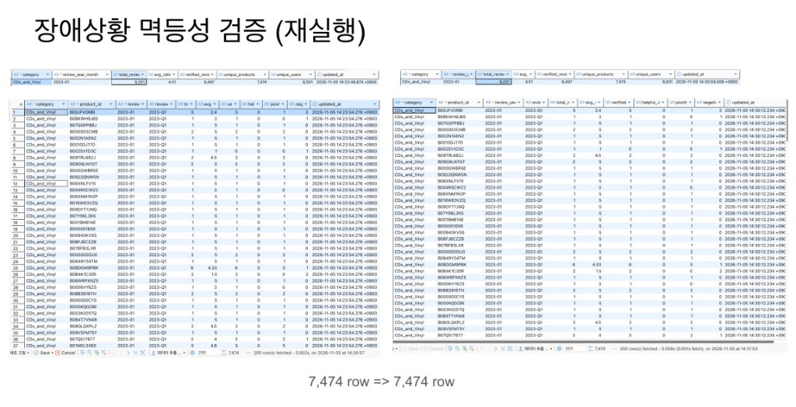
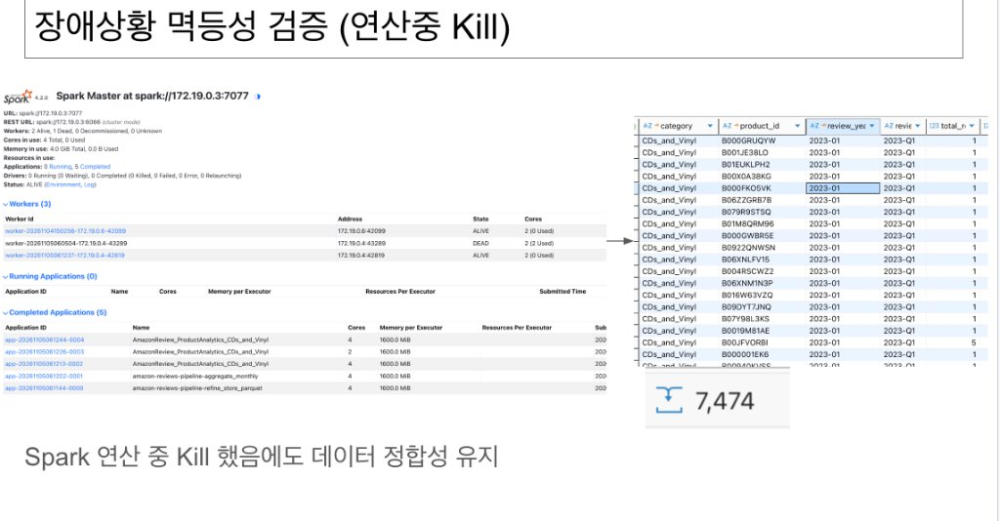

# Amazon 리뷰 수집·정제 파이프라인

## 사용 데이터 및 분석 목적

- **데이터셋:** Amazon Reviews 2023의 `All_Beauty` 카테고리
- **출처:** McAuley-Lab / Hugging Face Datasets (`McAuley-Lab/Amazon-Reviews-2023`)
- **현재 입력:** Hugging Face Datasets 직접 다운로드 URL (`All_Beauty.jsonl`)
  - `https://huggingface.co/datasets/McAuley-Lab/Amazon-Reviews-2023/resolve/main/raw/review_categories/All_Beauty.jsonl`
  - 수집기가 다운로드하여 `data/raw/All_Beauty.jsonl`에 적재 (이미 파일이 존재하면 다운로드 자동 스킵)
- **입력 규모:** 701,528행, 326,611,506바이트(약 311.5 MiB)
- **데이터 단위:** 사용자 리뷰 1건. 평점, 제목, 본문, 상품·사용자 식별자, 밀리초 단위 작성 시각 등을 포함합니다.

분석 목표는 어떤 상품의 어떤 문제부터 개선해야 하는가? 입니다.
현재는 분석에 사용할 데이터를 수집·정제하는 단계까지 구현했습니다.

| 향후 분석 | 제공하려는 결과 |
| --- | --- |
| 평점과 본문 감정 점수 비교 | 별점은 높지만 본문에 불만이 있는 리뷰 찾기 |
| 평점 구간별 키워드 분석 | 낮은 평점의 주요 불만과 높은 평점의 구매 이유 파악 |
| 상품별 월별 리뷰 수·평점 추이 | 상품 평가 악화와 리뷰 수 증가 추이 확인 |

약 70만 행으로 로컬 개발과 검증을 진행하기에 적절해 이 카테고리를 선택했습니다.
향후 다른 대용량 카테고리로 확장할 때도 수집·정제 구조를 활용하되,
입력 필드, DB 용량, 파티션 수와 처리 성능을 확인할 계획입니다.

## 현재 구조와 도구 선정 이유

**수집기(JSONL) → 원본 적재(`data/raw/`) → Raw Parquet 준비(`data/raw_parquet/`) → Spark 분산 정제 및 Parquet 저장(`data/processed/<category>/`) → PostgreSQL 월별 요약 집계(`monthly_review_summary`) → 품질 검증** 흐름으로 동작합니다.

| 계층 | 역할과 기술 스택 | 저장 포맷 및 위치 | 기본키(PK) / 식별자 |
| :--- | :--- | :--- | :--- |
| **1단계: 원본 수집** | 수집기(`collector.py`)가 외부 원본 JSONL을 로컬 스토리지에 안정적으로 다운로드 | JSONL (`data/raw/`) | 없음 (원시 로그 파일) |
| **2단계: Raw Parquet 준비** | `refine_reviews.py --step convert_raw_to_parquet`로 원본 JSONL을 월별 파티션 Raw Parquet으로 1회 변환 및 검증 (완전 시 Spark 미기동 Fast-Skip) | Parquet (`data/raw_parquet/<category>/`)<br/>`partitionBy("review_year_month")` | 없음 (원천 파티션 보관) |
| **3단계: 정제 & 중복 제거** | 대상 월 Raw Parquet 파티션만 직접 읽어 결측치 필터링 및 `review_id` 기준 분산 중복 제거 (해당 월 이미 존재 시 스킵) | Parquet (`data/processed/<category>/`)<br/>`partitionBy("review_year_month")` | `review_id` (UUID5: user_id + parent_asin + timestamp) |
| **4단계: 월별 요약 집계** | Spark로 카테고리-월별 리뷰 수, 평균 평점 등을 요약 집계 후 PostgreSQL UPSERT 적재 (멱등성 보장) | PostgreSQL (`public.monthly_review_summary`) | `(category, review_year_month)` (VARCHAR 복합 PK) |
| **5단계: 상품 분석 마트** | 상품별 월별 지표(분기 포함) 집계, 리뷰 급증(100%+) 뷰, 저/다리뷰 세그먼트 비교 마트 UPSERT | PostgreSQL (`public.product_monthly_metrics`, `public.product_segment_comparison`) | `(category, product_id, review_year_month)` 등 |
| **6단계: 품질 검증** | Python으로 집계 적재 건수, 평점 범위, 결측치, 뷰 조회 및 세그먼트 보존 검증 | 검증 스크립트 (SQL 쿼리) | - |

### 2단계(Bronze → Silver) 분리 및 장애 방어 설계

* **왜 2단계로 나누었나요? (풀 스캔 방지)**:
  매달 수백만 건의 원본 파일 전체를 처음부터 끝까지 다 읽으면 너무 느립니다. 그래서 **2단계(Bronze)**에서 원본을 월별 파티션 Parquet으로 딱 1번만 변환해 두고, **3단계(Silver)**에서는 이번 달 데이터만 쏙 골라 읽어 빠르게 정제합니다.
* **어떻게 안정성을 높였나요? (메모리 절약 & 장애 방어)**:
  * **메모리 부족(OOM) 방지**: 불필요한 캐시(`.cache()`)를 없애고 메모리를 1.6GB로 늘려 버퍼 부담을 줄였습니다.
  * **원자적 저장(Atomic Swap)**: 작업 중 서버가 꺼져도 데이터가 깨지지 않도록, 임시 폴더에서 먼저 작업한 뒤 성공했을 때만 한 번에 정상 폴더로 교체합니다.
  * **재실행 멱등성**: 작업이 실패해 다시 돌려도 PostgreSQL `UPSERT`를 적용해 데이터 중복 없이 기존 데이터만 안전하게 덮어씁니다.

### 저장 포맷을 고른 이유

1. **정제 원본 ➔ Parquet (컬럼 지향 포맷)**:
   - 70만 건 이상의 대용량 상세 데이터를 행 단위 RDBMS에 전부 저장하면 DB CPU/I/O 병목 및 스토리지 낭비가 발생합니다.
   - Parquet은 컬럼별 Snappy 압축률이 우수하며, `partitionBy("review_year_month")`로 월별 파티션 프루닝(Partition Pruning)과 필요한 컬럼만 읽는 컬럼 프루닝(Column Pruning)을 통해 대규모 분석 쿼리 속도를 극대화합니다. 일별 파티셔닝 대비 파일/디렉토리 수를 대폭 줄여 작은 파일 문제(Small Files Problem)를 방지합니다.
2. **집계 통계 ➔ PostgreSQL (관계형 데이터베이스)**:
   - 월별로 요약 집계된 데이터(약 260행)는 데이터 크기가 작고, Grafana 대시보드나 백엔드 서비스에서 빈번하고 빠른 포인트 조회가 일어납니다.
   - 인덱스와 트랜잭션(ACID)을 지원하는 RDBMS가 서빙 및 시각화 도구 연동에 가장 적합합니다.

### 실행 방법

파이프라인 실행은 호스트 머신의 `submit-job.sh` 스크립트를 통해 Docker 컨테이너 클러스터(`spark-master`) 내부로 전달되어 실행됩니다.

#### 1. 인프라 컨테이너 실행 (사전 준비)
```bash
docker compose up -d
```

#### 2. 원본 데이터 수집 실행
```bash
./submit-job.sh jobs/collector.py
```
- 이미 `data/raw/All_Beauty.jsonl`이 존재하고 크기가 유효할 경우, 네트워크 다운로드를 자동으로 스킵합니다.
- 처음부터 강제로 다시 다운로드 및 수집하려면 `--reset-state` 플래그를 추가합니다.

#### 3. Spark 정제 및 요약 집계 실행
```bash
# 1) 원본 JSONL -> 월별 Raw Parquet 파티션 변환 및 준비 (최초 1회 실행, 이미 완료 시 즉시 스킵)
./submit-job.sh jobs/refine_reviews.py --step convert_raw_to_parquet

# 2) 특정 월(예: 2023-01) 증분 실행 (해당 월 Raw Parquet만 직접 읽어 Full Scan 제거, 정제 파티션 존재 시 스킵)
./submit-job.sh jobs/refine_reviews.py --step refine_store_parquet --year-month 2023-01
./submit-job.sh jobs/refine_reviews.py --step aggregate_monthly --year-month 2023-01

# 3) 상품별 분석 마트 및 세그먼트 분석 실행 (PostgreSQL UPSERT)
./submit-job.sh jobs/product_analytics.py --step all --year-month 2023-01
# 또는 전체 기간 마트 적재
./submit-job.sh jobs/product_analytics.py --step all --year-month all

# 또는 과거 전체 데이터 일괄 실행
./submit-job.sh jobs/refine_reviews.py --step all --year-month all
```

#### 4. 결과 확인
- **월별 Raw Parquet 파티션 확인:**
  ```bash
  ls -lh data/raw_parquet/All_Beauty/
  ```
- **정제된 Parquet 파일 확인:**
  ```bash
  ls -lh data/processed/All_Beauty/
  ```
- **PostgreSQL 월별 요약 테이블 조회:**
  ```bash
  docker compose exec postgres psql -U postgres -d postgres -c "SELECT * FROM monthly_review_summary ORDER BY review_year_month DESC LIMIT 5;"
  ```
- **PostgreSQL 상품별 마트 및 급증 뷰 조회:**
  ```bash
  docker compose exec postgres psql -U postgres -d postgres -c "SELECT * FROM product_monthly_metrics LIMIT 5;"
  docker compose exec postgres psql -U postgres -d postgres -c "SELECT * FROM v_product_review_surge LIMIT 5;"
  docker compose exec postgres psql -U postgres -d postgres -c "SELECT * FROM product_segment_comparison;"
  ```

---

## Airflow DAG 설계 및 구현

월별 Amazon 리뷰 데이터 파이프라인 dag.py의 6단계 자동화 및 오케스트레이션 명세입니다.

### 1. DAG 구조 (병렬 분기 및 수렴)

`download_raw_data >> prepare_raw_parquet >> refine_store_parquet >> [aggregate_monthly, aggregate_product] >> validate_data`

* **`download_raw_data`**: 외부 원본 JSONL 다운로드 (기존 파일 존재 시 자동 스킵)
* **`prepare_raw_parquet`**: 원본 JSONL을 월별 파티션 Raw Parquet(`data/raw_parquet/<category>/`)으로 최초 1회 변환 및 무결성 검증. 루트 `_SUCCESS` 및 월별 파티션(`_SUCCESS`, `_manifest.json`)이 유효하면 Spark 세션 없이 0.1초 만에 즉시 정상 종료하여 매월 전체 JSONL 재스캔을 방지합니다.
* **`refine_store_parquet`**: 대상 월의 Raw Parquet 파티션(`review_year_month=YYYY-MM`)만 직접 읽어 결측치 필터링, UUID5 중복 제거 후 월별 정제 Parquet 저장 (해당 월 정제 파티션 이미 존재 시 스킵, Raw Parquet 부재 시 JSONL 스캔 폴백)
* **`aggregate_monthly`**: 월별 리뷰 수·평균 평점 요약 집계 후 PostgreSQL UPSERT 적재 (멱등성 보장, `aggregate_product`와 병렬 실행)
* **`aggregate_product`**: 상품별 월별 지표(review_quarter 포함) 집계, PostgreSQL `product_monthly_metrics` UPSERT 및 저/다리뷰 세그먼트 비교 마트(`product_segment_comparison`) 갱신 (`aggregate_monthly`와 병렬 실행)
* **`validate_data`**: DB 적재 건수, 평점(1.0~5.0) 이상치, 뷰 정상 동작 및 세그먼트 보존 검증

### 2. retry · backoff 전략

장애 유형에 따라 **재시도 대상**과 **즉시 로그 기록 대상**을 분리했습니다.

* **재시도 대상 (일시적 장애 자동 극복)**:
  - `download_raw_data`: 3회 재시도 (2분 ➔ 4분 ➔ 8분 지수 백오프, 외부 웹 서버 일시 타임아웃 대비)
  - `prepare_raw_parquet`: 1회 재시도 (5분 대기, Spark 일시 리소스 경합/OOM 대비)
  - `refine_store_parquet`: 1회 재시도 (5분 대기, Spark 일시 리소스 경합/OOM 대비)
  - `aggregate_monthly`: 2회 재시도 (3분 간격, PostgreSQL 커넥션 풀/트랜잭션 락 대비)
* **재시도 없음 (즉시 실패 감지)**:
  - `validate_data`: 0회 (재시도 없음). 데이터 결함/오염은 반복 실행해도 실패하므로 즉시 중단 후 `on_failure_callback`으로 콘솔 에러 로그 기록
  - ※ **실패 알림 기능 안내**: 현재 `notify_failure` 콜백은 외부 메신저 전송 대신 Airflow 태스크 콘솔 로그에 `[ALERT]`로 기록하도록 구현되어 있습니다. (실서비스 전환 시 Discord/Slack 웹훅 전송 코드로 확장 가능)

### 3. 스케줄 · 의존성 및 날짜 매핑

* **실행 주기 & 시각**: 매월 1일 자정 (`schedule="@monthly"`)
* **`start_date` 및 `end_date` 설정 이유와 정기 실행 전환 방법**:
  - **`start_date` 설정 이유**: 원본 데이터셋이 2000년 11월부터 시작하므로, 2000년대~2023년 사이의 어떤 과거 월(예: 2018-01 등)을 논리적 날짜로 백필하거나 수동 트리거해도 태스크가 스킵되지 않고 정상 생성되도록 `start_date=datetime(2000, 1, 1)`로 설정했습니다. (`catchup=False`이므로 과거 구간이 폭주하여 자동 실행되지 않습니다)
  - **`end_date` 설정 이유**: 본 실습 데이터셋은 과거 데이터(2023-09 마감)이므로, DAG 활성화 시 2023-10부터 현재(2026년)까지 데이터가 없는 빈 구간이 무의미하게 자동 스케줄링되는 것을 방지하기 위해 `end_date=datetime(2023, 10, 1)`로 설정했습니다.
  - **정기 실행 전환 방법**: 현재 시점 기준 매월 실시간 파이프라인으로 전환하려면 `end_date` 파라미터를 제거하면 되며, 과거 특정 월 테스트는 Airflow UI의 `Trigger DAG w/ config`에서 `{"year_month": "2023-01"}` 또는 원하는 과거 년월로 즉시 실행할 수 있습니다.
* **순서 선정 이유**: 원본 다운로드 ➔ Raw Parquet 준비 ➔ 월별 정제 Parquet 저장 ➔ DB 요약 집계 ➔ 품질 검증의 단계별 입력 데이터 의존성 보장
* **리플레이 날짜 매핑**: 과거(2000~2023년) 데이터를 재현하므로, Airflow 실행 날짜 대신 파라미터(`data_interval_start`의 `YYYY-MM`)를 과거 데이터 월과 1:1로 매핑하여 처리

### 4. 운영 참고 사항

* **정적 데이터셋 백필 최적화**: 현재 구조는 Raw Parquet 파티션과 완료 마커(`_SUCCESS`, `_manifest.json`)가 유효하면 원본 JSONL을 다시 읽지 않도록 설계되어 있어 과거 데이터셋 및 대규모 백필 시 불필요한 반복 I/O를 원천 차단합니다.
* **동적 누적 데이터 확장 방안**: 향후 원본 JSONL 파일에 실시간 신규 데이터가 주기적으로 누적되는 환경으로 확장할 경우, manifest에 원본 파일의 크기·수정 시각(mtime) 또는 체크섬 해시를 기록하여 파일 변경 감지 시에만 Raw Parquet을 재생성/증분 갱신하도록 확장할 수 있습니다.


### 5. 환경 설정 및 Git 보안 관리

* **환경 변수 분리**: DB 접속 정보 및 설정은 `.env`로 격리 관리하며, 신규 환경 설정을 위해 `.env.example`을 제공합니다.
* **Git 추적 제외 (`.gitignore`)**:
  * 실행 로그: `logs/`, `*.log`
  * 로컬 환경 변수: `.env`, `.env.*` (예외: `.env.example`)
  * OS 임시 파일: `**/.DS_Store`

---

## 대용량 확장 성능 측정 및 장애 복구 검증

### 1. 데이터 규모별(1x ~ 10x) 처리 성능 비교

데이터 양을 1배, 2배, 5배, 10배로 확장하여 동일한 Airflow DAG를 실행하고 각 배수별 처리 건수, 태스크별 소요 시간, 처리량(건/초)을 측정한 결과입니다.

| 태스크 | 1x (`All_Beauty`) | 2x (`Arts_Crafts`) | 5x (`CDs_and_Vinyl`) | 10x (`Grocery`) |
| :--- | :--- | :--- | :--- | :--- |
| **원본 처리 건수 (Raw)** | **701,528건** | **1,403,056건** | **3,507,640건** | **7,015,280건** |
| **정제 건수 (Refined)** | 693,547건 (98.9%) | 1,397,663건 (99.6%) | 3,485,173건 (99.4%) | 6,982,475건 (99.5%) |
| **상품-월별 마트 건수** | 413,109건 | 1,108,265건 | 2,539,511건 | 3,862,485건 |
| `download_raw_data` | 0.814초<br>(861,828 건/초) | 1.313초<br>(1,068,588 건/초) | 4.721초<br>(742,987 건/초) | 6.014초<br>(1,166,492 건/초) |
| `prepare_raw_parquet` | 19.569초<br>(35,849 건/초) | 20.667초<br>(67,889 건/초) | 30.860초<br>(113,663 건/초) | 33.068초<br>(212,147 건/초) |
| `refine_store_parquet` | 24.992초<br>(28,070 건/초) | 28.165초<br>(49,816 건/초) | 47.056초<br>(74,542 건/초) | 57.986초<br>(120,982 건/초) |
| `aggregate_monthly` | 36.673초<br>(19,129 건/초) | 68.000초<br>(20,633 건/초) | 17.265초<br>(203,165 건/초) | 25.403초<br>(276,160 건/초) |
| `aggregate_product` | 26.120초<br>(26,858 건/초) | 57.236초<br>(24,514 건/초) | 104초<br>(33,727 건/초) | 157초<br>(44,683 건/초) |
| `validate_data` | 2.061초<br>(340,382 건/초) | 3.720초<br>(377,166 건/초) | 20.985초<br>(167,150 건/초) | 31.953초<br>(219,550 건/초) |
| **전체 소요 시간** | **84.11초**<br>(8,341 건/초) | **121.86초**<br>(11,513 건/초) | **207.62초**<br>(16,894 건/초) | **286.02초**<br>(24,527 건/초) |

#### 🚨 병목 태스크 분석: 어느 태스크가 먼저 느려지나요?
* **가장 먼저 느려지는 태스크**: **`aggregate_product` (상품별 집계)**
  * 데이터가 10배 늘어날 때 소요 시간이 **26초 ➔ 157초**로 가장 가파르게 증가합니다 (전체 시간의 절반 이상 차지).
  * **이유**: 단순 '월별 집계'는 그룹이 몇 개 안 되지만, '상품별 집계'는 **수백만 개의 개별 상품 단위로 쪼개어 계산**하고 DB에 대량으로 저장(UPSERT)해야 해서 연산과 네트워크 부하가 가장 많이 몰리기 때문입니다.

---

### 2. 장애 상황 및 재실행 검증

실제 장애가 발생해도 데이터가 안전한지 2가지 시나리오로 검증했습니다.

#### ① 같은 월 다시 실행하기 (멱등성 검증)
* **내용**: 이미 처리한 2023년 1월 데이터를 한 번 더 실행해 봅니다.
* **결과**: 중복으로 쌓이지 않고 기존 데이터를 갱신하여 **정확히 7,474건 그대로 유지**됩니다 (`7,474 row => 7,474 row`).



#### ② 계산 도중 Spark 강제 종료하기 (장애 복구 검증)
* **내용**: Spark가 한창 일하는 도중에 워커 컨테이너를 강제로 꺼버립니다(`Kill` ➔ `1 Dead`).
* **결과**: 깨진 파일이 남지 않고 자동으로 재시도되어, 데이터 유실 없이 **원래 건수인 7,474건이 온전히 복구**됩니다.



