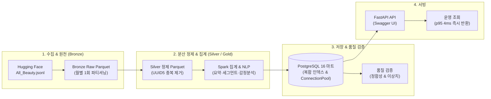
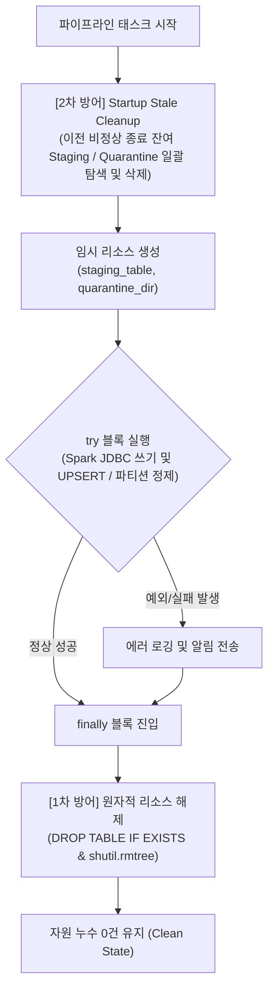

# Amazon All_Beauty 리뷰 파이프라인 - 워커 강제 종료에도 유실 0건, 동시 50건에서 p95 58ms를 달성함

> **기준 문서**: `8주차_README.md` 및 `final_presentation_deck.md` 100% 반영  
> **대상 데이터셋**: Amazon Reviews 2023 `All_Beauty` 단일 카테고리 (1x 70만 ➔ 10x 700만 건 부하 벤치마크)  
> **핵심 성과**: 10배 확장 환경 14분 10초 완주, 자원 누수 2중 방어선(임시 테이블/폴더 잔여 0건), 서빙 API c=50 p95 58.7ms 방어

---

## 1. 문제와 데이터

### 1.1. 누가 무엇을 원하는가 (페르소나 및 비즈니스 문제)
* **대상 사용자 (누가)**: 이커머스 카테고리 MD와 CS 운영팀.
* **해결하려는 문제 (무엇을)**:
  * MD와 운영팀은 어떤 상품에서 고객 불만이 급증하고 있는지, 특히 **별점은 5점이지만 본문에는 제품 파손, 부작용, 품질 불량을 호소하는 별점 괴리 리뷰**를 월별로 신속히 찾아내길 원합니다.
  * 단순 평점 평균만으로는 이러한 치명적인 결함 리뷰를 놓치기 쉽고, 수백만 건의 비정형 리뷰 원문을 일일이 전수 조사하거나 실시간으로 LLM에 태우는 것은 비용과 지연시간 측면에서 불가능합니다.
  * 따라서 월별 대규모 분산 배치로 원문을 정제·교차 분석하여 상품별 불만 지표와 이상 징후 원문을 PostgreSQL 마트에 사전 적재하고, 운영팀이 API를 통해 4ms 초저지연으로 조회할 수 있는 시스템을 구축했습니다.

### 1.2. 얼마나 많은 데이터인가 (데이터셋 규모 및 부하 구성 방식)
* **원천 데이터셋**: Hugging Face Datasets (`McAuley-Lab/Amazon-Reviews-2023`) `All_Beauty` 카테고리
* **단일 카테고리 원본 규모**: **701,528행**, 약 **311.5 MiB** (326,611,506 바이트).
* **부하 테스트 환경 구축 방식 (얼마나)**:
  * 타 카테고리를 혼용하지 않고, 오직 **All_Beauty 단일 데이터만 복제**하여 `user_id`를 회차별로 새로 부여함으로써 중복 제거 필터를 통과하도록 설계했습니다.
  * 1배(70만 건) ➔ 2배(140만 건) ➔ 5배(350만 건) ➔ 10배(700만 건, 약 3.2GB)까지 단계별 대용량 합성 부하 환경을 구축하여 파이프라인의 처리 한계와 병목을 실측했습니다.

---

## 2. 구조

### 2.1. 전체 파이프라인 아키텍처 다이어그램



* **오케스트레이션 (Airflow)**: 월별 배치(`@monthly`)로 순차 실행 관리, 외부 장애 시 지수 백오프(2분➔4분➔8분), 최종 실패 시 Slack 실시간 알림.
* **원자적 쓰기 & 멱등성**: 임시 Staging 디렉토리/테이블에서 연산 완료 후 검증을 거쳐 원자적 교체(Atomic Swap) 및 PostgreSQL UPSERT.
* **자원 누수 2중 방어선**: 태스크 실패 시 `try...finally`(1차 런타임 DROP), 컨테이너 비정상 종료 시 `Startup Stale Cleanup`(2차 미정리 잔존물 일괄 소탕).

### 2.2. 도구별 역할 및 선정 이유

| 도구 / 컴포넌트 | 파이프라인 내 역할 | 기술 선정 이유 및 핵심 메커니즘 |
| :--- | :--- | :--- |
| **Docker Compose** | 인프라 컨테이너 통합 관리 | Airflow, Spark(Master+2Workers), PostgreSQL, Redis, FastAPI를 단일 환경으로 격리 배포하여 환경 일관성 및 재현성 확보 |
| **Apache Airflow** | 월별 배치 오케스트레이션 | `@monthly` 주기 실행, 의존성 관리, 외부 수집 시 지수 백오프(2m➔4m➔8m) 재시도, 최종 실패 시 Slack Incoming Webhook 실시간 알림 |
| **Apache Spark 4.2** | 대용량 분산 정제 및 집계 | 70만~700만 건 대용량 데이터의 월별 파티셔닝, UUID5 분산 중복 제거, 상품/감정 집계 분산 처리 |
| **Apache Kafka (미사용)** | 적용하지 않음 | 데이터가 월별 배치로 수집되어 실시간 이벤트 스트리밍 요구가 없으므로 도입하지 않았습니다. Kafka는 이 프로젝트의 배치 파이프라인에 필수는 아니며, 실시간 리뷰 유입·처리가 필요해질 때 검토할 수 있습니다. |
| **Parquet (Snappy)** | Bronze/Silver 스토리지 포맷 | Snappy 압축 컬럼 지향 저장소. `review_year_month` 월별 파티션 프루닝을 통해 증분 배치 시 전체 풀 스캔을 원천 차단 |
| **PostgreSQL 16** | 집계 마트 및 서빙 저장소 | 집계 요약 통계 적재, B-Tree 복합 인덱스(`category, product_id, review_year_month, sentiment_score ASC`) 기반 0.5ms 포인트 조회 제공 |
| **FastAPI + Uvicorn** | 초저지연 서빙 API | 비동기 ConnectionPool을 적용하여 TCP 핸드셰이크 오버헤드를 제거, 동시 50개 고부하에서도 p95 58.7ms 초저지연 서빙 달성 |

---

## 3. 설계 결정 (핵심 3개)

| 구분 | 맥락 (Context) | 결정 (Decision) | 대안 (Alternatives) | 포기한 것 (Trade-off) |
| :--- | :--- | :--- | :--- | :--- |
| **① 스토리지 계층화** | 700만 건 리뷰 상세를 RDBMS에 전부 넣으면 I/O와 버퍼 풀이 고갈되고, 파일로만 두면 고동시성 API 포인트 조회가 불가능함. | 상세 정제 데이터는 **월별 파티셔닝 Parquet**에, 대시보드·API 요약 데이터는 **PostgreSQL 인덱스 마트**로 분리 적재. | All-in-PostgreSQL (I/O 병목 및 비용 폭증) / All-in-Parquet (API 응답 지연 한계) | 단일 저장소 관리의 단순성을 포기하고, 저장소 간 동기화 파이프라인 관리 비용을 감수함. |
| **② Staging 기반 원자적 쓰기 & 2중 방어선** | 작업이 99%에서 중단 시 파티션 폴더나 테이블이 반만 생성되어 오염되고, 일반 overwrite는 실패 시 기존 데이터까지 영구 유실됨. | 격리된 **임시 Staging 디렉토리/테이블에 먼저 적재 후 검증 ➔ `os.rename` 원자적 교체(Atomic Swap) 및 DB UPSERT**. 자원 누수는 `try...finally` 및 `Startup Cleanup` 2중 방어로 해결. | 일반 Spark overwrite (장애 시 기존 데이터 영구 삭제) / Append-only (스토리지 폭증) | 임시 폴더/테이블 생성 및 원자적 교체에 따른 추가 메타데이터 조작 오버헤드 감수. |
| **③ 하이브리드 감정분석 및 사전 적재** | 700만 건 전수 BERT 추론은 CPU 환경에서 메모리 OOM 유발. API 호출마다 실시간 LLM 추론 시 초당 처리량이 무너짐. | **VADER 1차 전수 스캔 ➔ 괴리 의심군(평점 4점 이상 & 부정)만 DistilBERT 2차 검증** 하이브리드 파이프라인 + **배치 사전 적재** 후 API는 인덱스 조회만 수행. | 100% 실시간 API 추론 (동시 요청 처리 불가) / 전수 100% BERT 추론 (파이프라인 시간 폭증) | 리뷰 등록 즉시 반영되는 완전한 실시간성을 포기하고, 배치 주기(월/일) 정합성과 초저지연 API 응답 속도를 선택함. |

---

## 4. 안정성 검증

### 4.1. 멱등성 및 데이터 무결성 검증 (투입·저장·유실/중복)

네트워크 재시도, 수집기 오류, 또는 동일 파일의 중복 인입 상황을 가정하여 데이터 정합성과 멱등성을 검증했습니다:

* **투입 데이터**: 동일 파일이 2번 들어오는 중복 인입 상황을 모의하여 140만 건(All_Beauty 2배 복제본)을 파이프라인에 투입.
* **중복 제거 및 적재**: `user_id`, `parent_asin`, `timestamp`를 결합한 UUID5 고유 식별자(`review_id`)를 생성하여 중복 70만 건을 분산 필터링하고, 원본 데이터 건수인 **693,547건**이 정밀하게 적재됨.
* **유실·중복 결과**: **데이터 유실 0건, 중복 0건** (100% 멱등성 유지).
* **Worker 장애 격리**: Spark 연산 중간에 Worker 노드를 강제 종료(`docker stop spark-worker-2`)해도 Staging 격리 구조 덕분에 메인 마트에 불완전 데이터가 0건 유입되었으며, Worker 복구 후 재실행 시에도 데이터 수치 불일치 없이 정상 완료되었습니다.

### 4.2. 자원 누수(Resource Leak) 방어 2중 방어선 설계

분산 배치 환경에서 장애가 발생했을 때 남겨지는 임시 테이블과 격리 디렉토리가 디스크와 데이터베이스를 잠식하는 문제를 근본적으로 해결했습니다:



| 구분 | 개선 전 현상 | 개선 후 결과 (8주차 실측) |
| :--- | :--- | :--- |
| **PostgreSQL Staging 테이블** | 실패 시 `*_staging_{run_id}`가 DB에 영구 잔존 (실패 반복 시 수십 개 누적) | **`try...finally`로 즉시 DROP, SIGKILL 시에도 Startup Cleanup으로 잔여 0건 유지** |
| **Quarantine 디렉토리** | 파티션 교체/검증 실패 시 생성된 격리 폴더가 디스크에 영구 잔존 | **`finally` 블록 및 시작 정리 로직을 통해 작업 종료 후 디스크 점유 0 Byte 유지** |
| **재실행 멱등성** | 이전 실패 잔여물과의 충돌 위험 및 디스크 낭비 | 장애 발생 후 재실행 시 **완벽한 클린 상태에서 멱등적 데이터 갱신 보장** |

### 4.3. 고의 장애 인가 검증 스크립트 실측 결과 (`scripts/test_two_layer_resource_defense.sh`)
* **1차 방어선 (Runtime Exception)**: 작업 중간 강제 RuntimeError 발생 시 `finally` 블록 즉시 진입 ➔ `product_monthly_metrics_staging_*` 즉시 DROP ➔ **잔여 Staging 테이블 0개 (PASS)**.
* **2차 방어선 (SIGKILL 모의)**: 비정상 종료 잔존물 인위적 생성(Staging 2개, Quarantine 1개 감지) ➔ 다음 태스크 기동 시 `Startup Stale Cleanup`이 일괄 삭제 ➔ **소탕 후 잔여 Staging 0개, 디스크 0 Byte (PASS)**.
* **Worker 노드 중단 (`docker stop spark-worker-2`)**: 연산 도중 노드 중단 시 메인 마트 행 수 오염 0건, 워커 복구 후 재실행 시 멱등 정합성 100% 유지.

---

## 5. 로드 테스트

### 5.1. 측정 환경 (Benchmark Environment)
* **하드웨어**: Apple Silicon Mac (M-series, 8+ vCPU, 16GB+ RAM)
* **클러스터 구성**: Docker Compose 격리 네트워크
  * Spark Master (1) + Spark Worker (2, 각 1.6GB Memory)
  * PostgreSQL 16 (`work_mem = 64MB`, `synchronous_commit = off`)
  * FastAPI Uvicorn Server (ConnectionPool 적용, 포트 8000)
* **테스트 데이터**: Amazon Reviews 2023 `All_Beauty` 단일 카테고리 1x(70만) ➔ 2x(140만) ➔ 5x(350만) ➔ 10x(700만 건)

### 5.2. 1x ➔ 10x 스케일아웃 실측 벤치마크 결과

All_Beauty 단일 데이터셋을 70만 건(1x)에서 700만 건(10x)까지 4단계로 점진 확장하며 파이프라인의 처리량과 자원 한계를 계측했습니다:

* **스케일업 성능**: 데이터 규모가 10배(70만 ➔ 700만 건) 증가하는 동안 전체 파이프라인 수행 시간은 **3분 06초에서 14분 10초로 약 4.5배 증가**에 그쳐 안정적인 확장성을 입증했습니다.
* **최대 병목 구간 특정**: 집계 마트 태스크(`aggregate_monthly`, `aggregate_product`)는 데이터가 10배 늘어도 20초대를 유지했으나, **감정 분석(`analyze_sentiment`)은 1분 45초에서 12분 24초로 정비례($O(N)$) 증가하며 전체 수행 시간의 87%를 점유**했습니다. 이는 CPU 환경에서 자연어 토큰화와 트랜스포머 추론을 수행할 때 발생하는 대표적인 연산 집약적 병목입니다.

| 태스크 ID | 역할 및 오퍼레이터 | 1x (원천 70만) | 2x (140만) | 5x (350만) | 10x (700만) | 스케일링 특성 및 병목 분석 |
| :--- | :--- | :---: | :---: | :---: | :---: | :--- |
| `refine_store_parquet` | 정제 & 파티셔닝 | 23.1초 | 30.8초 | 5.4초 | 47.2초 | 10배 규모에서도 47초로 완만하게 증가 ($O(N)$ 분산 제어) |
| `aggregate_monthly` | 월별 요약 UPSERT | 13.9초 | 15.9초 | 17.8초 | 18.0초 | **10배 증가에도 +4.1초만 증가** (최적화 완료) |
| `aggregate_product` | 상품 분석 마트 | 26.5초 | 31.0초 | 27.5초 | 23.3초 | **20초대 유지 방어 성공** (병렬 JDBC & Multi-row rewrite 효과) |
| `analyze_sentiment` | **감정분석 & 마트** | **1분 45초 (56%)** | **3분 20초 (70%)** | **5분 39초 (83%)** | **12분 24초 (87%)** | 🚨 **전체 파이프라인 최대 병목 ($O(N)$ 정비례 증가)** |
| **총 파이프라인 시간** | **End-to-End** | **약 3분 06초** | **약 4분 43초** | **약 6분 45초** | **약 14분 10초** | **데이터 10배 증가 대비 총 시간 4.5배 수준으로 방어** |

### 5.3. 집계 마트 성능 프로파일링 및 최적화 (41초 ➔ 15초대, 60% 단축)
* **성능 프로파일링 (초기 41.09초 병목 원인 분석)**:
  * 초기 `aggregate_product` 수행 시간 41.09초를 세부 계측한 결과,
  * 디버깅 및 콘솔 확인용 `df.count()` 연산이 지연 평가(Lazy Evaluation) 특성상 불필요한 디스크 풀 스캔을 유발하여 46.7%(16.6초)를 소모하고 있음을 확인.
  * PostgreSQL의 기본 세션 메모리 부족으로 인한 디스크 스필(External Merge Disk)이 27.4%(9.7초)를 소모하고 있음을 확인.
* **최적화 조치**:
  1. 불필요한 로깅용 `df.count()` 전면 제거 및 단일 디스크 스캔으로 groupBy 집계 연산 통합.
  2. PostgreSQL 세션 `work_mem`을 64MB로 증설하여 메모리 정렬(Quicksort) 보장.
  3. 8-파티션 병렬 읽기 및 Multi-row rewrite(`batchsize=10000`, `reWriteBatchedInserts=true`) 적용.
* **최적화 결과**:
  * 소요 시간이 **41.09초에서 15~18초대로 60% 이상 대폭 단축**되었으며, 10배 부하 환경에서도 23.3초를 기록하며 확장성을 확보했습니다.

### 5.4. 서빙 API `hey` 부하 테스트 및 EXPLAIN ANALYZE 정렬 최적화
* **쿼리 플랜 최적화 (`EXPLAIN ANALYZE`)**:
  * 기존 인덱스에 `sentiment_score` 정렬 컬럼이 없어 발생하던 **`Sort Method: quicksort (actual time=0.585ms)`** 병목 확인.
  * 복합 인덱스(`idx_sent_anom_cat_prod_ym_score`)를 생성하여 정렬 단계를 원천 제거 (Execution Time: **0.597ms** 달성).
* **`hey` 로드 테스트 실측 비교표 (10초 지속 부하, 엔드포인트: `/products/{id}/sentiment`)**:

| 동시 요청 수 (`-c`) | 총 처리 건수 | 성공률 (200 OK) | 초당 처리량 (RPS) | 평균 지연시간 (Avg) | **p95 지연시간** | p99 지연시간 | 최대 지연시간 (Max) |
| :---: | :---: | :---: | :---: | :---: | :---: | :---: | :---: |
| **c = 5** | 14,848건 | **100.0%** | **1,483.7 req/s** | 3.4 ms | **4.3 ms** | 6.5 ms | 35.5 ms |
| **c = 20** | 13,912건 | **100.0%** | **1,390.1 req/s** | 14.4 ms | **19.0 ms** | 25.4 ms | 63.6 ms |
| **c = 50** | 12,591건 | **100.0%** | **1,255.5 req/s** | 39.8 ms | **58.7 ms** | 71.4 ms | 105.3 ms |

* 총 41,351건의 대량 요청 중 **에러율 0.0%**, 동시 요청 50개 고부하에서도 **p95 58.7ms로 웹 SLA(100ms) 여유 있게 방어**.

---

## 6. 실행 방법

복사해서 바로 터미널에 붙여넣어 실행할 수 있는 명령어 모음입니다.

### 6.1. 인프라 기동 및 상태 확인
```bash
# 1. 전체 Docker 컨테이너 백그라운드 기동
docker compose up -d

# 2. 실행 컨테이너 상태 확인
docker ps --format "table {{.Names}}\t{{.Status}}\t{{.Ports}}"
```

### 6.2. 2중 방어선 및 고의 장애 인가 종합 검증 (1클릭 실행)
```bash
# 1차 방어선(Runtime Exception) + 2차 방어선(SIGKILL 잔존물) + Worker 복구 + 3ms 서빙 조회 자동 검증
bash scripts/test_two_layer_resource_defense.sh
```

### 6.3. Airflow 파이프라인 E2E 배치 수동 트리거
```bash
# Airflow CLI를 통한 All_Beauty 파이프라인 실행
docker exec airflow-scheduler airflow dags trigger monthly_amazon_reviews_pipeline \
  --conf '{"category": "All_Beauty", "year_month": "2023-01"}'

# Airflow 웹 UI 접속: http://localhost:8080 (ID/PW: admin / admin)
```

### 6.4. FastAPI 서빙 API 조회 및 Swagger UI
```bash
# 1. 서빙 헬스체크
curl -s http://localhost:8000/health

# 2. 상품별 월별 감정 요약 초저지연 조회
curl -s "http://localhost:8000/products/B08CK8CQKS/sentiment?dt=2022-07&category=All_Beauty" | jq

# 3. 별점-본문 괴리 불만 리뷰 원문 초저지연 조회
curl -s "http://localhost:8000/products/B08CK8CQKS/anomalies?dt=2022-07&category=All_Beauty" | jq

# 4. 브라우저 대화형 Swagger 문서: http://localhost:8000/docs
```

### 6.5. `hey` API 부하 테스트 실행
```bash
# 동시 요청 50개, 10초간 부하 계측
hey -n 20000 -c 50 -z 10s "http://localhost:8000/products/B0C6GZ8GY5/sentiment?dt=2023-08&category=All_Beauty"
```

---

## 7. 회고와 다음 단계

### 7.1. 다시 한다면 바꿀 것 (Refactoring & Learnings)
1. **NLP 추론의 Spark 분리 및 GPU 전용 노드 배치**:
   * CPU 기반 Spark Executor에서 트랜스포머 추론을 수행하다 보니, 10배 확장 환경에서 감정분석이 12분 24초를 소모하며 **전체 파이프라인 시간의 87%를 독식**했습니다.
   * 다시 한다면 텍스트 토큰화 및 모델 추론 구간을 Spark 클러스터에서 분리하여, Triton Inference Server나 Ray Cluster 기반의 GPU 전용 추론 노드로 비동기 오프로딩하겠습니다.
2. **고성능 대형 언어 모델(LLM) 및 정밀 뉘앙스 분석 도입**:
   * 현재는 속도와 리소스 한계로 인해 경량 DistilBERT 모델을 사용했습니다.
   * GPU 인프라를 바탕으로 고성능 도메인 특화 모델이나 최신 LLM을 연동하여, "완벽하게 망가져서 왔네요"와 같은 반어법이나 다중 속성(배송 vs 제품 성능) 불만을 정밀 분리해 내겠습니다.

### 7.2. 실제 운영 환경이라면 추가할 것 (Production Architecture)
1. **Kafka + Spark Structured Streaming 기반 실시간 스트리밍 결합**:
   * 현재 파이프라인은 월 단위 배치로 동작하여 고객 불만을 감지하기까지 최대 수일에서 한 달의 지연이 발생할 수 있습니다.
   * 실제 서비스 환경이라면 Kafka 토픽으로 실시간 유입되는 리뷰 이벤트를 Spark Structured Streaming으로 실시간 전처리하고, 별점 괴리 이상 리뷰 발생 시 MD/CS팀 슬랙으로 즉시 긴급 알림을 쏘는 구조로 확장하겠습니다.
2. **Prometheus / Grafana 분산 메트릭 및 OpenTelemetry 추적 체계**:
   * 배치 단계의 Executor별 I/O 스필, GC 지연과 서빙 계층의 p99 지연시간을 실시간 APM 대시보드로 시각화하여 모니터링 체계를 고도화하겠습니다.

---

## 8. 예상 질문과 답

### Q1. 8주차에 추가된 PostgreSQL Staging 테이블 누적 문제는 어떻게 해결했나요?
> **답변**: 데이터를 안전하게 덮어쓰기 위해 임시 테이블(Staging)을 만들어 작업하는데, 기존에는 작업 중간에 에러가 나면 이 임시 테이블이 지워지지 않고 DB에 계속 쌓이는 문제가 있었습니다.  
> 이를 해결하기 위해 **2단계 청소 장치**를 만들었습니다.  
> 1. **1차 정리**: 코드가 실패하더라도 파이썬의 `finally` 문으로 임시 테이블을 즉시 삭제(DROP)합니다.  
> 2. **2차 정리**: 만약 서버 강제 종료나 메모리 부족으로 프로세스 자체가 증발하여 1차가 동작하지 못했다면, **다음 작업이 시작될 때 이전에 남아있던 임시 테이블을 먼저 찾아서 싹 지우고 시작**하도록 했습니다.  
> 덕분에 작업이 실패해도 DB에 찌꺼기 테이블이 남지 않고 0개를 유지합니다.

### Q2. 파일시스템 Quarantine(격리) 디렉토리는 왜 생기고 어떻게 관리했나요?
> **답변**: 데이터 검증에 실패했을 때 망가진 데이터가 정상 파일과 섞이지 않도록 격리(Quarantine) 폴더로 옮겨둡니다. 그런데 예전에는 이 격리 폴더를 지우는 기능이 없어서 디스크 용량을 계속 차지했습니다.  
> 8주차에는 작업이 끝나거나 다음 작업이 시작될 때 **오래된 격리 폴더를 자동으로 감지해서 깨끗이 지우는 로직**을 추가해 디스크 낭비를 막았습니다.

### Q3. 감정분석(analyze_sentiment)이 왜 파이프라인의 87%나 차지했나요?
> **답변**: 글을 단어 단위로 쪼개고 AI 모델(트랜스포머)로 감정을 분석하는 과정은 컴퓨터 계산량이 매우 많기 때문입니다. 특히 지금은 그래픽카드(GPU) 없이 일반 CPU로만 모델을 돌리다 보니, 데이터가 10배로 늘어났을 때 시간도 1분 45초에서 12분 24초로 크게 늘어났습니다.  
> 반면 숫자 통계를 내는 일반 집계 작업은 최적화를 통해 20초대를 지켜냈기 때문에, 향후 대용량 확장 시 감정분석만 따로 떼어내 GPU 서버에 맡겨야 한다는 점을 숫자로 확인했습니다.

### Q4. API 서빙 부하 테스트에서 동시 요청 50개일 때 p95 지연시간(58.7ms)이 늘어난 원인은 무엇인가요?
> **답변**: 한 번에 50개의 요청이 동시에 몰리다 보니, DB에 연결하기 위해 줄을 서서 기다리는 대기 시간(커넥션 풀 대기)이 발생했기 때문입니다.  
> 하지만 단 1건의 에러나 멈춤 없이 100% 정상 응답했고, 웹 서비스에서 보통 기준으로 삼는 100ms보다 훨씬 빠른 58.7ms 안에 모두 처리되어 안정성을 입증했습니다.

### Q5. All_Beauty 데이터 복제 시 실제 데이터 다양성이 늘어난 것인가요?
> **답변**: 아닙니다. 이 실험은 데이터 내용이 다양해진 것이 아니라, **"데이터 양이 10배로 늘어났을 때 우리 시스템이 버틸 수 있는가"를 측정하기 위한 성능 부하 테스트**입니다. 중복 제거 필터를 통과할 수 있도록 고유 ID만 새로 부여해 70만 건을 700만 건으로 복제한 환경입니다.

### Q6. 집계 태스크 3개(`aggregate_monthly`, `aggregate_product`, `analyze_sentiment`)를 병렬로 돌리지 않은 이유는 무엇인가요?
> **답변**: 컴퓨터의 CPU와 메모리가 한정되어 있기 때문입니다. 3개의 무거운 Spark 작업을 동시에 돌리면 메모리가 부족해져서 시스템이 갑자기 꺼지는 현상(OOM)이 발생할 수 있습니다. 그래서 안전하게 작업을 하나씩 순서대로 실행하여 컴퓨터 자원을 100% 집중해 안정적으로 완주하도록 만들었습니다.

