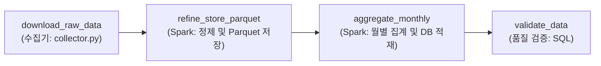

# Amazon 리뷰 수집·정제 파이프라인

## 사용 데이터 및 분석 목적

- **데이터셋:** Amazon Reviews 2023의 `All_Beauty` 카테고리
- **출처:** McAuley-Lab / Hugging Face Datasets (`McAuley-Lab/Amazon-Reviews-2023`)
- **현재 입력:** Hugging Face Datasets 직접 다운로드 URL (`All_Beauty.jsonl`)
  - `https://huggingface.co/datasets/McAuley-Lab/Amazon-Reviews-2023/resolve/main/raw/review_categories/All_Beauty.jsonl`
  - 수집기가 다운로드하여 `data/raw/All_Beauty.jsonl`에 적재 (이미 파일이 존재하면 다운로드 자동 스킵)
- **입력 규모:** 701,528행, 326,611,506바이트(약 311.5 MiB)
- **데이터 단위:** 사용자 리뷰 1건. 평점, 제목, 본문, 상품·사용자 식별자, 밀리초 단위 작성 시각 등을 포함합니다.

분석 목표는 어떤 상품의 어떤 문제부터 개선해야 하는가? 입니다.
현재는 분석에 사용할 데이터를 수집·정제하는 단계까지 구현했습니다.

| 향후 분석 | 제공하려는 결과 |
| --- | --- |
| 평점과 본문 감정 점수 비교 | 별점은 높지만 본문에 불만이 있는 리뷰 찾기 |
| 평점 구간별 키워드 분석 | 낮은 평점의 주요 불만과 높은 평점의 구매 이유 파악 |
| 상품별 월별 리뷰 수·평점 추이 | 상품 평가 악화와 리뷰 수 증가 추이 확인 |

약 70만 행으로 로컬 개발과 검증을 진행하기에 적절해 이 카테고리를 선택했습니다.
향후 다른 대용량 카테고리로 확장할 때도 수집·정제 구조를 활용하되,
입력 필드, DB 용량, 파티션 수와 처리 성능을 확인할 계획입니다.

## 현재 구조와 도구 선정 이유

**수집기(JSONL) → 원본 적재(`data/raw/`) → Spark 분산 정제 및 Parquet 저장(`data/processed/reviews/`) → PostgreSQL 월별 요약 집계(`monthly_review_summary`) → 품질 검증** 흐름으로 동작합니다.

| 계층 | 역할과 기술 스택 | 저장 포맷 및 위치 | 기본키(PK) / 식별자 |
| :--- | :--- | :--- | :--- |
| **1단계: 원본 수집** | 수집기(`collector.py`)가 외부 원본 JSONL을 로컬 스토리지에 안정적으로 다운로드 | JSONL (`data/raw/`) | 없음 (원시 로그 파일) |
| **2단계: 정제 & 중복 제거** | Spark로 명시적 `StructType` 스키마 적용 로딩, 결측치 필터링 및 `review_id` 기준 분산 중복 제거 | Parquet (`data/processed/reviews/`)<br/>`partitionBy("review_year_month")` | `review_id` (UUID5: user_id + parent_asin + timestamp) |
| **3단계: 월별 요약 집계** | Spark로 월별 리뷰 수, 평균 평점 등을 요약 집계 후 PostgreSQL UPSERT 적재 (멱등성 보장) | PostgreSQL (`public.monthly_review_summary`) | `review_year_month` (VARCHAR(7) PRIMARY KEY) |
| **4단계: 품질 검증** | Python으로 집계 적재 건수, 평점 범위, 결측치 및 갱신 시각 검증 | 검증 스크립트 (SQL 쿼리) | - |

### 저장 포맷을 고른 이유

1. **정제 원본 ➔ Parquet (컬럼 지향 포맷)**:
   - 70만 건 이상의 대용량 상세 데이터를 행 단위 RDBMS에 전부 저장하면 DB CPU/I/O 병목 및 스토리지 낭비가 발생합니다.
   - Parquet은 컬럼별 Snappy 압축률이 우수하며, `partitionBy("review_year_month")`로 월별 파티션 프루닝(Partition Pruning)과 필요한 컬럼만 읽는 컬럼 프루닝(Column Pruning)을 통해 대규모 분석 쿼리 속도를 극대화합니다. 일별 파티셔닝 대비 파일/디렉토리 수를 대폭 줄여 작은 파일 문제(Small Files Problem)를 방지합니다.
2. **집계 통계 ➔ PostgreSQL (관계형 데이터베이스)**:
   - 월별로 요약 집계된 데이터(약 260행)는 데이터 크기가 작고, Grafana 대시보드나 백엔드 서비스에서 빈번하고 빠른 포인트 조회가 일어납니다.
   - 인덱스와 트랜잭션(ACID)을 지원하는 RDBMS가 서빙 및 시각화 도구 연동에 가장 적합합니다.

### 실행 방법

파이프라인 실행은 호스트 머신의 `submit-job.sh` 스크립트를 통해 Docker 컨테이너 클러스터(`spark-master`) 내부로 전달되어 실행됩니다.

#### 1. 인프라 컨테이너 실행 (사전 준비)
```bash
docker compose up -d
```

#### 2. 원본 데이터 수집 실행
```bash
./submit-job.sh jobs/collector.py
```
- 이미 `data/raw/All_Beauty.jsonl`이 존재하고 크기가 유효할 경우, 네트워크 다운로드를 자동으로 스킵합니다.
- 처음부터 강제로 다시 다운로드 및 수집하려면 `--reset-state` 플래그를 추가합니다.

#### 3. Spark 정제 및 요약 집계 실행
```bash
# 특정 월(예: 2023-01) 증분 실행 (이미 파티션 존재 시 정제 자동 스킵)
./submit-job.sh jobs/refine_reviews.py --step refine_store_parquet --year-month 2023-01
./submit-job.sh jobs/refine_reviews.py --step aggregate_monthly --year-month 2023-01

# 또는 과거 전체 데이터 일괄 실행
./submit-job.sh jobs/refine_reviews.py --step all --year-month all
```

#### 4. 결과 확인
- **정제된 Parquet 파일 확인:**
  ```bash
  ls -lh data/processed/reviews/
  ```
- **PostgreSQL 월별 집계 테이블 조회:**
  ```bash
  docker compose exec postgres psql -U postgres -d postgres -c "SELECT * FROM monthly_review_summary ORDER BY review_year_month DESC LIMIT 5;"
  ```

---

## Airflow DAG 설계 및 구현

월별 Amazon 리뷰 데이터 파이프라인([`dags/dag.py`](file:///Users/steven/Documents/메타코드_Local/2026-data-engineer-live-project/dags/dag.py))의 4단계 자동화 및 오케스트레이션 명세입니다.

### 1. DAG 구조 (단일 파이프라인 4단계 순차 체이닝)



* **`download_raw_data`**: 외부 원본 JSONL 다운로드 (기존 파일 존재 시 자동 스킵)
* **`refine_store_parquet`**: 스키마 적용 및 중복 제거 후 월별 Parquet 저장 (해당 월 파티션 이미 존재 시 스킵)
* **`aggregate_monthly`**: 월별 리뷰 수·평균 평점 요약 집계 후 PostgreSQL UPSERT 적재
* **`validate_data`**: DB 적재 건수 및 평점(1.0~5.0) 이상치 최종 검증

### 2. retry · backoff 전략

장애 유형에 따라 **재시도 대상**과 **즉시 로그 기록 대상**을 분리했습니다.

* **재시도 대상 (일시적 장애 자동 극복)**:
  - `download_raw_data`: 3회 재시도 (2분 ➔ 4분 ➔ 8분 지수 백오프, 외부 웹 서버 일시 타임아웃 대비)
  - `refine_store_parquet`: 1회 재시도 (5분 대기, Spark 일시 리소스 경합/OOM 대비)
  - `aggregate_monthly`: 2회 재시도 (3분 간격, PostgreSQL 커넥션 풀/트랜잭션 락 대비)
* **재시도 없음 (즉시 실패 감지)**:
  - `validate_data`: 0회 (재시도 없음). 데이터 결함/오염은 반복 실행해도 실패하므로 즉시 중단 후 `on_failure_callback`으로 콘솔 에러 로그 기록
  - ※ **실패 알림 기능 안내**: 현재 `notify_failure` 콜백은 외부 메신저 전송 대신 Airflow 태스크 콘솔 로그에 `[ALERT]`로 기록하도록 구현되어 있습니다. (실서비스 전환 시 Discord/Slack 웹훅 전송 코드로 확장 가능)

### 3. 스케줄 · 의존성 및 날짜 매핑

* **실행 주기 & 시각**: 매월 1일 자정 (`schedule="@monthly"`)
* **`end_date` 설정 이유와 정기 실행 전환 방법**:
  - **설정 이유**: 본 실습 데이터셋은 과거 데이터(2023-09 마감)이므로, DAG 활성화 시 2023-10부터 현재(2026년)까지 데이터가 없는 빈 구간이 무의미하게 자동 스케줄링되는 것을 방지하기 위해 `end_date=datetime(2023, 10, 1)`로 설정했습니다.
  - **정기 실행 전환 방법**: 현재 시점 기준 매월 실시간 파이프라인으로 전환하려면 `end_date` 파라미터를 제거하면 되며, 과거 특정 월 테스트는 Airflow UI의 `Trigger DAG w/ config`에서 `{"year_month": "2023-01"}`로 즉시 실행할 수 있습니다.
* **순서 선정 이유**: 원본 다운로드 ➔ 정제 Parquet 저장 ➔ DB 요약 집계 ➔ 품질 검증의 단계별 입력 데이터 의존성 보장
* **리플레이 날짜 매핑**: 과거(2023년) 데이터를 재현하므로, Airflow 실행 날짜 대신 파라미터(`data_interval_start`의 `YYYY-MM`)를 과거 데이터 월과 1:1로 매핑하여 처리

### 4. 피드백 체크리스트 & 보너스 과제 (멱등성)

* **스키마 직접 정의**: Spark `StructType`으로 필드 불일치 즉시 감지
* **품질 검증 조건 강화**: 총 집계 월수 0건 체크뿐 아니라, `invalid_reviews > 0`(리뷰 수 <= 0인 비정상 행) 및 `invalid_ratings > 0`(평점 1~5점 이탈)을 모두 감지하여 즉시 예외(`ValueError`)를 발생시킴
* **장애 복구**: 수집 상태 파일 및 월별 Parquet 파티션 사전 감지 스킵(0.1초) 탑재
* **멱등성(Idempotency)**: PostgreSQL `review_year_month` PK 업서트(`ON CONFLICT DO UPDATE`) 적용으로 **같은 날짜를 여러 번 실행해도 데이터 중복 없이 최신 상태 유지**

```bash
# 동일 월(2023-01) 2회 실행 후 멱등성 검증 쿼리 (단 1행 유지 및 updated_at만 갱신)
docker compose exec postgres psql -U postgres -d postgres -c "SELECT review_year_month, total_reviews, avg_rating, updated_at FROM monthly_review_summary WHERE review_year_month = '2023-01';"
```


### 5. 환경 설정 및 Git 보안 관리

* **환경 변수 분리**: DB 접속 정보 및 설정은 `.env`로 격리 관리하며, 신규 환경 설정을 위해 `.env.example`을 제공합니다.
* **Git 추적 제외 (`.gitignore`)**:
  * 실행 로그: `logs/`, `*.log`
  * 로컬 환경 변수: `.env`, `.env.*` (예외: `.env.example`)
  * OS 임시 파일: `**/.DS_Store`
