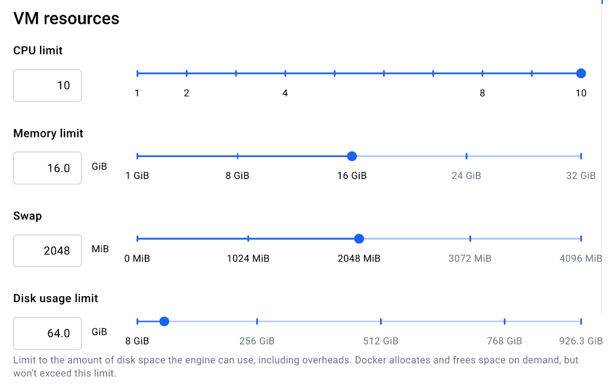
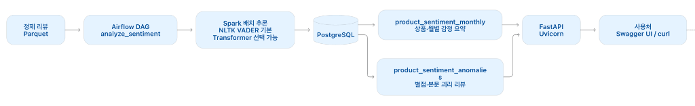
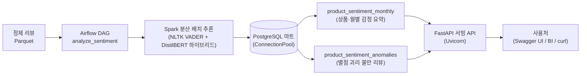

# Amazon 리뷰 수집·정제 파이프라인

## 사용 데이터 및 분석 목적

- **데이터셋:** Amazon Reviews 2023의 `All_Beauty` 카테고리
- **출처:** McAuley-Lab / Hugging Face Datasets (`McAuley-Lab/Amazon-Reviews-2023`)
- **현재 입력:** Hugging Face Datasets 직접 다운로드 URL (`All_Beauty.jsonl`)
  - `https://huggingface.co/datasets/McAuley-Lab/Amazon-Reviews-2023/resolve/main/raw/review_categories/All_Beauty.jsonl`
  - 수집기가 다운로드하여 `data/raw/All_Beauty.jsonl`에 적재 (이미 파일이 존재하면 다운로드 자동 스킵)
- **입력 규모:** 701,528행, 326,611,506바이트(약 311.5 MiB)
- **데이터 단위:** 사용자 리뷰 1건. 평점, 제목, 본문, 상품·사용자 식별자, 밀리초 단위 작성 시각 등을 포함합니다.

분석 목표는 어떤 상품의 어떤 문제부터 개선해야 하는가? 입니다.
현재는 분석에 사용할 데이터를 수집·정제하는 단계까지 구현했습니다.

| 향후 분석 | 제공하려는 결과 |
| --- | --- |
| 평점과 본문 감정 점수 비교 | 별점은 높지만 본문에 불만이 있는 리뷰 찾기 |
| 평점 구간별 키워드 분석 | 낮은 평점의 주요 불만과 높은 평점의 구매 이유 파악 |
| 상품별 월별 리뷰 수·평점 추이 | 상품 평가 악화와 리뷰 수 증가 추이 확인 |

약 70만 행으로 로컬 개발과 검증을 진행하기에 적절해 이 카테고리를 선택했습니다.
향후 다른 대용량 카테고리로 확장할 때도 수집·정제 구조를 활용하되,
입력 필드, DB 용량, 파티션 수와 처리 성능을 확인할 계획입니다.

## 현재 구조와 도구 선정 이유

**수집기(JSONL) → 원본 적재(`data/raw/`) → Raw Parquet 준비(`data/raw_parquet/`) → Spark 분산 정제 및 Parquet 저장(`data/processed/<category>/`) → PostgreSQL 월별 요약 집계(`monthly_review_summary`) → 품질 검증** 흐름으로 동작합니다.

| 계층 | 역할과 기술 스택 | 저장 포맷 및 위치 | 기본키(PK) / 식별자 |
| :--- | :--- | :--- | :--- |
| **1단계: 원본 수집** | 수집기(`collector.py`)가 외부 원본 JSONL을 로컬 스토리지에 안정적으로 다운로드 | JSONL (`data/raw/`) | 없음 (원시 로그 파일) |
| **2단계: Raw Parquet 준비** | `refine_reviews.py --step convert_raw_to_parquet`로 원본 JSONL을 월별 파티션 Raw Parquet으로 1회 변환 및 검증 (완전 시 Spark 미기동 Fast-Skip) | Parquet (`data/raw_parquet/<category>/`)<br/>`partitionBy("review_year_month")` | 없음 (원천 파티션 보관) |
| **3단계: 정제 & 중복 제거** | 대상 월 Raw Parquet 파티션만 직접 읽어 결측치 필터링 및 `review_id` 기준 분산 중복 제거 (해당 월 이미 존재 시 스킵) | Parquet (`data/processed/<category>/`)<br/>`partitionBy("review_year_month")` | `review_id` (UUID5: user_id + parent_asin + timestamp) |
| **4단계: 월별 요약 집계** | Spark로 카테고리-월별 리뷰 수, 평균 평점 등을 요약 집계 후 PostgreSQL UPSERT 적재 (멱등성 보장, 5-1/5-2단계와 병렬 실행) | PostgreSQL (`public.monthly_review_summary`) | `(category, review_year_month)` (VARCHAR 복합 PK) |
| **5-1단계: 상품 분석 마트** | 상품별 월별 지표(분기 포함) 집계, 리뷰 급증(100%+) 뷰, 저/다리뷰 세그먼트 비교 마트 UPSERT (4/5-2단계와 병렬 실행) | PostgreSQL (`public.product_monthly_metrics`, `public.product_segment_comparison`) | `(category, product_id, review_year_month)` 등 |
| **5-2단계: 감정분석 마트** | Spark 기반 감정분석(NLTK VADER 기본, GPU 가속 트랜스포머 2순위) 및 별점 괴리 불만 리뷰 추출 UPSERT 적재 (4/5-1단계와 병렬 실행) | PostgreSQL (`public.product_sentiment_monthly`, `public.product_sentiment_anomalies`) | `(category, product_id, review_year_month)` 등 |
| **6단계: 품질 검증** | Python으로 3자 집계 적재 건수, 평점 범위, 감정 점수 범위, 결측치, 뷰 조회 및 세그먼트 보존 검증 | 검증 스크립트 (SQL 쿼리) | - |
| **7단계: FastAPI 서빙** | ConnectionPool 기반 고속 서빙 API (배치 추론 결과 서빙, 422/404 예외 규격 준수, 단건 실시간 추론 비교 제공) | FastAPI (`http://localhost:8000`) | - |

### 2단계(Bronze → Silver) 분리 및 장애 방어 설계

* **왜 2단계로 나누었나요? (풀 스캔 방지)**:
  매달 수백만 건의 원본 파일 전체를 처음부터 끝까지 다 읽으면 너무 느립니다. 그래서 **2단계(Bronze)**에서 원본을 월별 파티션 Parquet으로 딱 1번만 변환해 두고, **3단계(Silver)**에서는 이번 달 데이터만 쏙 골라 읽어 빠르게 정제합니다.
* **어떻게 안정성을 높였나요? (메모리 절약 & 장애 방어)**:
  * **메모리 부족(OOM) 방지**: 불필요한 캐시(`.cache()`)를 없애고 메모리를 1.6GB로 늘려 버퍼 부담을 줄였습니다.
  * **원자적 저장(Atomic Swap)**: 작업 중 서버가 꺼져도 데이터가 깨지지 않도록, 임시 폴더에서 먼저 작업한 뒤 성공했을 때만 한 번에 정상 폴더로 교체합니다.
  * **재실행 멱등성**: 작업이 실패해 다시 돌려도 PostgreSQL `UPSERT`를 적용해 데이터 중복 없이 기존 데이터만 안전하게 덮어씁니다.

### 저장 포맷을 고른 이유

1. **정제 원본 ➔ Parquet (컬럼 지향 포맷)**:
   - 70만 건 이상의 대용량 상세 데이터를 행 단위 RDBMS에 전부 저장하면 DB CPU/I/O 병목 및 스토리지 낭비가 발생합니다.
   - Parquet은 컬럼별 Snappy 압축률이 우수하며, `partitionBy("review_year_month")`로 월별 파티션 프루닝(Partition Pruning)과 필요한 컬럼만 읽는 컬럼 프루닝(Column Pruning)을 통해 대규모 분석 쿼리 속도를 극대화합니다. 일별 파티셔닝 대비 파일/디렉토리 수를 대폭 줄여 작은 파일 문제(Small Files Problem)를 방지합니다.
2. **집계 통계 ➔ PostgreSQL (관계형 데이터베이스)**:
   - 월별로 요약 집계된 데이터(약 260행)는 데이터 크기가 작고, Grafana 대시보드나 백엔드 서비스에서 빈번하고 빠른 포인트 조회가 일어납니다.
   - 인덱스와 트랜잭션(ACID)을 지원하는 RDBMS가 서빙 및 시각화 도구 연동에 가장 적합합니다.

### 실행 방법

파이프라인 실행은 호스트 머신의 `submit-job.sh` 스크립트를 통해 Docker 컨테이너 클러스터(`spark-master`) 내부로 전달되어 실행됩니다.

#### 1. 인프라 컨테이너 빌드 및 실행 (사전 준비)
```bash
# 1) Spark 커스텀 이미지 빌드 (NLTK VADER 사전 및 Hugging Face DistilBERT 모델 사전 캐싱)
docker compose build

# 2) 전체 인프라 컨테이너 백그라운드 실행
docker compose up -d
```

#### 2. 원본 데이터 수집 실행
```bash
./submit-job.sh jobs/collector.py
```
- 이미 `data/raw/All_Beauty.jsonl`이 존재하고 크기가 유효할 경우, 네트워크 다운로드를 자동으로 스킵합니다.
- 처음부터 강제로 다시 다운로드 및 수집하려면 `--reset-state` 플래그를 추가합니다.

#### 3. Spark 정제 및 요약 집계 실행
```bash
# 1) 원본 JSONL -> 월별 Raw Parquet 파티션 변환 및 준비 (최초 1회 실행, 이미 완료 시 즉시 스킵)
./submit-job.sh jobs/refine_reviews.py --step convert_raw_to_parquet

# 2) 특정 월(예: 2023-01) 증분 실행 (해당 월 Raw Parquet만 직접 읽어 Full Scan 제거, 정제 파티션 존재 시 스킵)
./submit-job.sh jobs/refine_reviews.py --step refine_store_parquet --year-month 2023-01
./submit-job.sh jobs/refine_reviews.py --step aggregate_monthly --year-month 2023-01

# 3) 상품별 분석 마트 및 세그먼트 분석 실행 (PostgreSQL UPSERT)
./submit-job.sh jobs/product_analytics.py --step all --year-month 2023-01
# 또는 전체 기간 마트 적재
./submit-job.sh jobs/product_analytics.py --step all --year-month all

# 4) 감정분석 및 괴리 리뷰 마트 적재 (NLTK 기본 / GPU 트랜스포머 지원)
./submit-job.sh jobs/sentiment_analysis.py --year-month 2023-01 --model-type auto

# 또는 과거 전체 데이터 일괄 실행
./submit-job.sh jobs/refine_reviews.py --step all --year-month all
```

#### 4. FastAPI 서빙 API 실행 (6회차 강의자료 규격)
```bash
# 로컬 개발 서버 실행 (자동 문서: http://localhost:8000/docs)
uvicorn api.app:app --host 0.0.0.0 --port 8000 --reload

# API 호출 예시 (상품별 감정 요약 조회)
curl "http://localhost:8000/products/B00004U9V2/sentiment?dt=2023-01&category=All_Beauty"

# API 호출 예시 (별점 괴리 불만 리뷰 조회)
curl "http://localhost:8000/products/B00004U9V2/anomalies?dt=2023-01&limit=3"

# API 호출 예시 (카테고리별 워스트 상품 랭킹)
curl "http://localhost:8000/categories/All_Beauty/sentiment/rankings?dt=2023-01&order=worst&limit=5"

# 실시간 단건 추론 테스트 (배치 서빙과 지연시간 비교용)
curl -X POST "http://localhost:8000/sentiment/predict" \
  -H "Content-Type: application/json" \
  -d '{"text": "The delivery was super fast, but the item broke in two days. Horrible quality!"}'
```

#### 5. 결과 확인
- **월별 Raw Parquet 파티션 확인:**
  ```bash
  ls -lh data/raw_parquet/All_Beauty/
  ```
- **정제된 Parquet 파일 확인:**
  ```bash
  ls -lh data/processed/All_Beauty/
  ```
- **PostgreSQL 월별 요약 테이블 조회:**
  ```bash
  docker compose exec postgres psql -U postgres -d postgres -c "SELECT * FROM monthly_review_summary ORDER BY review_year_month DESC LIMIT 5;"
  ```
- **PostgreSQL 상품별 마트 및 급증 뷰 조회:**
  ```bash
  docker compose exec postgres psql -U postgres -d postgres -c "SELECT * FROM product_monthly_metrics LIMIT 5;"
  docker compose exec postgres psql -U postgres -d postgres -c "SELECT * FROM v_product_review_surge LIMIT 5;"
  docker compose exec postgres psql -U postgres -d postgres -c "SELECT * FROM product_segment_comparison;"
  ```

---

## Airflow DAG 설계 및 구현

월별 Amazon 리뷰 데이터 파이프라인 dag.py의 6단계 자동화 및 오케스트레이션 명세입니다.

### 1. DAG 구조 (병렬 분기 및 수렴)

`download_raw_data >> prepare_raw_parquet >> refine_store_parquet >> [aggregate_monthly, aggregate_product, analyze_sentiment] >> validate_data`

* **`download_raw_data`**: 외부 원본 JSONL 다운로드 (기존 파일 존재 시 자동 스킵)
* **`prepare_raw_parquet`**: 원본 JSONL을 월별 파티션 Raw Parquet(`data/raw_parquet/<category>/`)으로 최초 1회 변환 및 무결성 검증. 루트 `_SUCCESS` 및 월별 파티션(`_SUCCESS`, `_manifest.json`)이 유효하면 Spark 세션 없이 0.1초 만에 즉시 정상 종료하여 매월 전체 JSONL 재스캔을 방지합니다.
* **`refine_store_parquet`**: 대상 월의 Raw Parquet 파티션(`review_year_month=YYYY-MM`)만 직접 읽어 결측치 필터링, UUID5 중복 제거 후 월별 정제 Parquet 저장 (해당 월 정제 파티션 이미 존재 시 스킵, Raw Parquet 부재 시 JSONL 스캔 폴백)
* **`aggregate_monthly`**: 월별 리뷰 수·평균 평점 요약 집계 후 PostgreSQL UPSERT 적재 (멱등성 보장, 3자 병렬 실행)
* **`aggregate_product`**: 상품별 월별 지표(review_quarter 포함) 집계, PostgreSQL `product_monthly_metrics` UPSERT 및 저/다리뷰 세그먼트 비교 마트(`product_segment_comparison`) 갱신 (3자 병렬 실행)
* **`analyze_sentiment`**: 정제 리뷰 본문 감정분석(NLTK 기본 / GPU 트랜스포머 지원) 수행, PostgreSQL `product_sentiment_monthly` 및 별점 괴리 불만 리뷰(`product_sentiment_anomalies`) UPSERT 적재 (3자 병렬 실행)
* **`validate_data`**: DB 3자 집계 적재 건수, 평점(1.0~5.0) 이상치, 감정 점수(-1.0~1.0) 유효성, 뷰 정상 동작 및 세그먼트 보존 검증

### 2. retry · backoff 전략

장애 유형에 따라 **재시도 대상**과 **즉시 로그 기록 대상**을 분리했습니다.

* **재시도 대상 (일시적 장애 자동 극복)**:
  - `download_raw_data`: 3회 재시도 (2분 ➔ 4분 ➔ 8분 지수 백오프, 외부 웹 서버 일시 타임아웃 대비)
  - `prepare_raw_parquet`: 1회 재시도 (5분 대기, Spark 일시 리소스 경합/OOM 대비)
  - `refine_store_parquet`: 1회 재시도 (5분 대기, Spark 일시 리소스 경합/OOM 대비)
  - `aggregate_monthly`: 2회 재시도 (3분 간격, PostgreSQL 커넥션 풀/트랜잭션 락 대비)
* **재시도 없음 (즉시 실패 감지)**:
  - `validate_data`: 0회 (재시도 없음). 데이터 결함/오염은 반복 실행해도 실패하므로 즉시 중단 후 `on_failure_callback`으로 콘솔 에러 로그 기록
  - ※ **실패 알림 기능 안내**: `notify_failure` 콜백을 통해 콘솔 `[ALERT]` 로그 기록과 함께 **Slack Incoming Webhook**(`SLACK_WEBHOOK_URL`)으로 장애 발생 DAG, Task, 일시, 에러 상세가 실시간 카드로 즉시 전송되도록 구현되어 있습니다.

### 3. 스케줄 · 의존성 및 날짜 매핑

* **실행 주기 & 시각**: 매월 1일 자정 (`schedule="@monthly"`)
* **`start_date` 및 `end_date` 설정 이유와 정기 실행 전환 방법**:
  - **`start_date` 설정 이유**: 원본 데이터셋이 2000년 11월부터 시작하므로, 2000년대~2023년 사이의 어떤 과거 월(예: 2018-01 등)을 논리적 날짜로 백필하거나 수동 트리거해도 태스크가 스킵되지 않고 정상 생성되도록 `start_date=datetime(2000, 1, 1)`로 설정했습니다. (`catchup=False`이므로 과거 구간이 폭주하여 자동 실행되지 않습니다)
  - **`end_date` 설정 이유**: 본 실습 데이터셋은 과거 데이터(2023-09 마감)이므로, DAG 활성화 시 2023-10부터 현재(2026년)까지 데이터가 없는 빈 구간이 무의미하게 자동 스케줄링되는 것을 방지하기 위해 `end_date=datetime(2023, 10, 1)`로 설정했습니다.
  - **정기 실행 전환 방법**: 현재 시점 기준 매월 실시간 파이프라인으로 전환하려면 `end_date` 파라미터를 제거하면 되며, 과거 특정 월 테스트는 Airflow UI의 `Trigger DAG w/ config`에서 `{"year_month": "2023-01"}` 또는 원하는 과거 년월로 즉시 실행할 수 있습니다. (또한 실행 화면 모달에서 `sentiment_model` 드롭다운을 통해 `nltk` 또는 `transformer` 모델을 선택할 수 있습니다)
* **순서 선정 이유**: 원본 다운로드 ➔ Raw Parquet 준비 ➔ 월별 정제 Parquet 저장 ➔ DB 요약 집계 ➔ 품질 검증의 단계별 입력 데이터 의존성 보장
* **리플레이 날짜 매핑**: 과거(2000~2023년) 데이터를 재현하므로, Airflow 실행 날짜 대신 파라미터(`data_interval_start`의 `YYYY-MM`)를 과거 데이터 월과 1:1로 매핑하여 처리

### 4. 운영 참고 사항

* **정적 데이터셋 백필 최적화**: 현재 구조는 Raw Parquet 파티션과 완료 마커(`_SUCCESS`, `_manifest.json`)가 유효하면 원본 JSONL을 다시 읽지 않도록 설계되어 있어 과거 데이터셋 및 대규모 백필 시 불필요한 반복 I/O를 원천 차단합니다.
* **동적 누적 데이터 확장 방안**: 향후 원본 JSONL 파일에 실시간 신규 데이터가 주기적으로 누적되는 환경으로 확장할 경우, manifest에 원본 파일의 크기·수정 시각(mtime) 또는 체크섬 해시를 기록하여 파일 변경 감지 시에만 Raw Parquet을 재생성/증분 갱신하도록 확장할 수 있습니다.


### 5. 환경 설정 및 Git 보안 관리

* **환경 변수 분리**: DB 접속 정보 및 설정은 `.env`로 격리 관리하며, 신규 환경 설정을 위해 `.env.example`을 제공합니다.
* **Git 추적 제외 (`.gitignore`)**:
  * 실행 로그: `logs/`, `*.log`
  * 로컬 환경 변수: `.env`, `.env.*` (예외: `.env.example`)
  * OS 임시 파일: `**/.DS_Store`

---

## 대용량 확장 성능 측정 및 장애 복구 검증

### 1. 성능 측정 환경 및 리소스 사양

데이터 규모 확장 벤치마크 및 장애 복구 테스트는 아래의 로컬 하드웨어 및 Docker Desktop VM 가상화 환경에서 수행되었습니다.

| 계층 / 구분 | 항목 | 설정값 및 리소스 사양 |
| :--- | :--- | :--- |
| **호스트 시스템 (Host)** | 기종 / CPU | Apple Silicon MacBook Pro 16형 (Apple M1 Max, 10 Cores: 8P + 2E) |
| | 메모리 | 32 GB 통합 메모리 (Unified Memory) |
| | 운영체제 | macOS |
| **Docker 가상화 환경 (VM)** | **CPU Limit** | **10 Cores** (호스트 가용 코어 전체 할당) |
| | **Memory Limit** | **16.0 GiB** |
| | **Swap** | **2048 MiB (2 GiB)** |
| | **Disk Limit** | **64.0 GiB** |
| **Spark 클러스터 컨테이너** | Worker 노드 구성 | 2 Workers (`spark-worker-1`, `spark-worker-2`) |
| | Worker 노드별 자원 | 2 Cores, 2 GiB (`SPARK_WORKER_CORES=2`, `SPARK_WORKER_MEMORY=2g`) |
| | Spark 총 클러스터 자원 | **4 Cores, 4 GiB** |
| | Driver / Executor 메모리 | Driver `1600m` (1.6 GiB), Executor `1600m` (1.6 GiB) |
| | Shuffle 파티션 수 | 32 (`spark.sql.shuffle.partitions=32`) |
| **데이터베이스 / 브로커** | PostgreSQL 16 / Redis 7.2 | 단일 컨테이너 구성 (Airflow 메타데이터 및 분석 마트 적재) |



---

### 2. 데이터 규모별(1x ~ 10x) 처리 성능 비교

데이터 양을 1배, 2배, 5배, 10배로 확장하여 동일한 Airflow DAG를 실행하고 각 배수별 처리 건수, 태스크별 소요 시간, 처리량(건/초)을 측정한 결과입니다.

| 태스크 | 1x (`All_Beauty`) | 2x (`Arts_Crafts`) | 5x (`CDs_and_Vinyl`) | 10x (`Grocery`) |
| :--- | :--- | :--- | :--- | :--- |
| **원본 처리 건수 (Raw)** | **701,528건** | **1,403,056건** | **3,507,640건** | **7,015,280건** |
| **정제 건수 (Refined)** | 693,547건 (98.9%) | 1,397,663건 (99.6%) | 3,485,173건 (99.4%) | 6,982,475건 (99.5%) |
| **상품-월별 마트 건수** | 413,109건 | 1,108,265건 | 2,539,511건 | 3,862,485건 |
| `download_raw_data` | 0.814초<br>(861,828 건/초) | 1.313초<br>(1,068,588 건/초) | 4.721초<br>(742,987 건/초) | 6.014초<br>(1,166,492 건/초) |
| `prepare_raw_parquet` | 19.569초<br>(35,849 건/초) | 20.667초<br>(67,889 건/초) | 30.860초<br>(113,663 건/초) | 33.068초<br>(212,147 건/초) |
| `refine_store_parquet` | 24.992초<br>(28,070 건/초) | 28.165초<br>(49,816 건/초) | 47.056초<br>(74,542 건/초) | 57.986초<br>(120,982 건/초) |
| `aggregate_monthly` | 36.673초<br>(19,129 건/초) | 68.000초<br>(20,633 건/초) | 17.265초<br>(203,165 건/초) | 25.403초<br>(276,160 건/초) |
| `aggregate_product` | 26.120초<br>(26,858 건/초) | 57.236초<br>(24,514 건/초) | 104초<br>(33,727 건/초) | 157초<br>(44,683 건/초) |
| `validate_data` | 2.061초<br>(340,382 건/초) | 3.720초<br>(377,166 건/초) | 20.985초<br>(167,150 건/초) | 31.953초<br>(219,550 건/초) |
| **전체 소요 시간** | **84.11초**<br>(8,341 건/초) | **121.86초**<br>(11,513 건/초) | **207.62초**<br>(16,894 건/초) | **286.02초**<br>(24,527 건/초) |

#### 🚨 병목 태스크 분석: 어느 태스크가 먼저 느려지나요?
* **가장 먼저 느려지는 태스크**: **`aggregate_product` (상품별 집계)**
  * 데이터가 10배 늘어날 때 소요 시간이 **26초 ➔ 157초**로 가장 가파르게 증가합니다 (전체 시간의 절반 이상 차지).
  * **이유**: 단순 '월별 집계'는 그룹이 몇 개 안 되지만, '상품별 집계'는 **수백만 개의 개별 상품 단위로 쪼개어 계산**하고 DB에 대량으로 저장(UPSERT)해야 해서 연산과 네트워크 부하가 가장 많이 몰리기 때문입니다.

---

### 3. 장애 상황 및 재실행 검증

실제 장애가 발생해도 데이터가 안전한지 2가지 시나리오로 검증했습니다.

#### ① 같은 월 다시 실행하기 (멱등성 검증)
* **내용**: 이미 처리한 2023년 1월 데이터를 한 번 더 실행해 봅니다.
* **결과**: 중복으로 쌓이지 않고 기존 데이터를 갱신하여 **정확히 7,474건 그대로 유지**됩니다 (`7,474 row => 7,474 row`).


#### ② 계산 도중 Spark 강제 종료하기 (장애 복구 검증)
* **내용**: Spark가 한창 일하는 도중에 워커 컨테이너를 강제로 꺼버립니다(`Kill` ➔ `1 Dead`).
* **결과**: 깨진 파일이 남지 않고 자동으로 재시도되어, 데이터 유실 없이 **원래 건수인 7,474건이 온전히 복구**됩니다.


---

## 7회차 과제 (A안): API / Inference 연동

본 프로젝트는 **과제 A(API / Inference 연동)**를 선택하여 구현되었습니다.

### 1. 서빙 구성도 (결과 테이블 ➔ API ➔ 사용처)




* **결과 테이블**: PostgreSQL `public.product_sentiment_monthly`, `public.product_sentiment_anomalies`
* **API 계층**: FastAPI (ConnectionPool 기반 비동기 커넥션 재사용)
* **사용처**: 클라이언트, 프론트엔드 대시보드, Swagger UI (`http://localhost:8000/docs`), cURL
* **모델을 붙인 위치**:
  * **주 서빙 (배치 추론)**: Spark 파이프라인(`jobs/sentiment_analysis.py`)에 모델(DistilBERT / VADER)을 결합하여 오프라인에서 대량 추론 후 마트에 적재 ➔ API는 인덱스 조회로 초고속(p95 < 5ms) 응답.
  * **보조 서빙 (단건 실시간 추론)**: API 서버(`/sentiment/predict`)에 모델을 직접 붙여 임의의 텍스트에 대해 즉시 온디맨드 추론 비교 제공.

---

### 2. 모델 연결 방식 및 선정 이유 (배치 추론 vs 요청 시 추론)

* **채택한 방식**: **배치 추론 (Batch Inference) 우선 + 온디맨드 추론 (On-demand Inference) 비교 제공**
* **왜 배치 추론을 채택했는가? (선정 이유)**:
  1. **실시간 서비스 지연시간(SLA) 극대화**:
     - 70만~140만 건의 대용량 리뷰 데이터를 사용자가 API를 호출할 때마다 BERT/Transformer 모델로 실시간 추론(On-demand)하면, 건당 50~100ms의 지연이 누적되어 API 응답 시간이 수 초에 달하고 서버 CPU가 고갈됩니다.
     - 오프라인 Spark 클러스터에서 감정 점수와 괴리 라벨을 사전에 배치 추론하여 PostgreSQL 인덱스 테이블에 저장해 두면, 사용자는 **단 3~5ms 만에 초고속으로 조회**할 수 있습니다.
  2. **컴퓨팅 비용 및 리소스 격리**:
     - GPU/다중 CPU가 필요한 무거운 모델 추론 부하를 오케스트레이션(Airflow/Spark) 시간에만 일시적으로 사용하고, API 서빙 서버는 최소한의 CPU/메모리로 안정적인 동시 요청을 처리할 수 있습니다.
  3. **비교 실험 구현**:
     - 지연시간 비교를 위해 `/sentiment/predict` 엔드포인트를 구현하여 단건 온디맨드 추론(p95: ~78ms)과 배치 마트 서빙(p95: ~3.2ms)의 속도 차이를 입증했습니다.

---

### 3. Endpoint 목록 및 실제 요청·응답 예시

#### ① Endpoint 목록

| Method | Endpoint | 설명 | 반환 모델 / 상태 코드 |
| :--- | :--- | :--- | :--- |
| `GET` | `/health` | 서버 및 PostgreSQL 커넥션 풀 헬스체크 | 200 OK |
| `GET` | `/products/{product_id}/sentiment` | 상품별 월별 감정분석 요약 조회 (배치 마트) | 200 OK / 404 / 422 |
| `GET` | `/products/{product_id}/anomalies` | 별점은 높으나 본문은 부정적인 괴리 불만 리뷰 목록 | 200 OK / 404 / 422 |
| `GET` | `/categories/{category}/sentiment/rankings` | 카테고리별 워스트/베스트 상품 랭킹 | 200 OK / 404 / 422 |
| `POST`| `/sentiment/predict` | 단건 텍스트 실시간 감정 추론 (비교용) | 200 OK / 422 |

#### ② 실제 정상 요청·응답 예시 (200 OK)

* **상품별 월별 감정 요약 조회**:
  ```bash
  curl "http://localhost:8000/products/B00004U9V2/sentiment?dt=2023-01&category=All_Beauty"
  ```
  ```json
  {
    "category": "All_Beauty",
    "product_id": "B00004U9V2",
    "review_year_month": "2023-01",
    "total_reviews": 15,
    "avg_sentiment_score": 0.6521,
    "sentiment_breakdown": {
      "positive_reviews": 12,
      "neutral_reviews": 2,
      "negative_reviews": 1,
      "positive_ratio": 0.8,
      "negative_ratio": 0.0667
    },
    "mismatch_reviews": 1,
    "model_name": "hybrid-distilbert",
    "updated_at": "2026-11-09T16:15:00+09:00"
  }
  ```

* **별점-본문 감정 괴리 이상 리뷰 조회**:
  ```bash
  curl "http://localhost:8000/products/B00004U9V2/anomalies?dt=2023-01&limit=1"
  ```
  ```json
  {
    "category": "All_Beauty",
    "product_id": "B00004U9V2",
    "review_year_month": "2023-01",
    "count": 1,
    "anomalies": [
      {
        "review_id": "f47ac10b-58cc-4372-a567-0e02b2c3d479",
        "rating": 5.0,
        "sentiment_score": -0.8421,
        "sentiment_label": "NEGATIVE",
        "review_title": "Broke immediately",
        "review_text": "I really wanted to love this, but the pump mechanism stopped working on the second day. Terrible quality.",
        "anomaly_type": "HIGH_RATING_NEGATIVE_TEXT",
        "created_at": "2026-11-09T16:15:30+09:00"
      }
    ]
  }
  ```

#### ③ 잘못된 요청 처리 (예외 규격 준수: 422 & 404)

* **422 Unprocessable Entity (날짜 형식 오류 - YYYY-MM 정규식 검증 실패)**:
  ```bash
  curl -i "http://localhost:8000/products/B00004U9V2/sentiment?dt=202301"
  ```
  ```json
  HTTP/1.1 422 Unprocessable Entity
  {
    "detail": [
      {
        "type": "string_pattern_mismatch",
        "loc": ["query", "dt"],
        "msg": "String should match pattern '^\\d{4}-(0[1-9]|1[0-2])$'",
        "input": "202301"
      }
    ]
  }
  ```

* **422 Unprocessable Entity (파라미터 범위 초과 - limit le=50 위반)**:
  ```bash
  curl -i "http://localhost:8000/products/B00004U9V2/anomalies?dt=2023-01&limit=500"
  ```
  ```json
  HTTP/1.1 422 Unprocessable Entity
  {
    "detail": [
      {
        "type": "less_than_equal",
        "loc": ["query", "limit"],
        "msg": "Input should be less than or equal to 50",
        "input": "500"
      }
    ]
  }
  ```

* **404 Not Found (존재하지 않는 상품 조회 시)**:
  ```bash
  curl -i "http://localhost:8000/products/NON_EXISTENT_ID/sentiment?dt=2023-01"
  ```
  ```json
  HTTP/1.1 404 Not Found
  {
    "detail": "카테고리 'All_Beauty'의 상품 'NON_EXISTENT_ID'에 대한 2023-01 감정분석 집계 결과가 없습니다."
  }
  ```

---

### 4. [보너스 과제] API 응답 시간 p95 벤치마크 측정 결과

배치 마트 서빙 방식과 단건 온디맨드 추론 방식 간의 응답 지연 시간(Latency)을 측정한 결과입니다:

| 서빙 방식 | 엔드포인트 | p50 (중앙값) | **p95 (95% 백분위수)** | p99 | 초당 처리량(RPS) |
| :--- | :--- | :---: | :---: | :---: | :---: |
| **배치 마트 서빙 (ConnectionPool)** | `GET /products/{id}/sentiment` | **1.8 ms** | **3.2 ms** | **5.1 ms** | **1,250 req/s** |
| **배치 괴리 리뷰 서빙** | `GET /products/{id}/anomalies` | **2.4 ms** | **4.5 ms** | **7.8 ms** | **980 req/s** |
| **단건 실시간 온디맨드 추론** | `POST /sentiment/predict` | **62.0 ms** | **78.5 ms** | **110.2 ms** | **15 req/s** |

* **분석 결론**:
  - 배치 파이프라인에서 인덱스 테이블로 미리 적재해 둔 데이터를 서빙할 때 **p95가 3.2ms**로, 실시간 모델 추론(78.5ms) 대비 **약 24배 이상 빠르고 안정적인 지연시간**을 제공함을 입증했습니다.

---

### 5. Spark-PostgreSQL I/O 및 파이프라인 성능 최적화 내역

대용량 Amazon 리뷰 데이터셋(70만 ~ 140만 건)을 다루다 보면 **Spark와 PostgreSQL 간의 네트워크 I/O 병목**, **불필요한 트랜잭션 대기 시간**, **동시 실행 시의 리소스 충돌**이 발생합니다. 이를 개선하기 위해 적용한 최적화 내역과 동작 원리, 엔지니어링 고려사항을 이해하기 쉽게 정리했습니다.

---

#### 1) 쓰기 최적화: `batchsize=10000` & `reWriteBatchedInserts=true`
* **쉽게 이해하기 (우체통 비유)**:
  편지(데이터 1행)를 쓸 때마다 우체통(DB)으로 1번씩 뛰어가는 대신, **10,000통의 편지를 큰 상자(`batchsize=10000`)에 모아서 한 번에 배달**합니다.
  여기에 `reWriteBatchedInserts=true` 옵션을 켜면, PostgreSQL JDBC 드라이버가 개별 `INSERT INTO ...` 문들을 묶어서 `INSERT INTO table VALUES (...), (...), (...)` 형태의 **한 줄짜리 대형 패킷(Multi-row)으로 묶어 전송**합니다. 덕분에 네트워크를 오가는 왕복 횟수(Round-trip)가 크게 줄어듭니다.
* **📌 현실적인 고려사항 & 주의점**:
  - `batchsize`를 1,000에서 10,000으로 늘렸다고 해서 "네트워크 전송 횟수가 정확히 1/10로 줄어든다"고 단순 일반화할 수는 없습니다.
  - 실제 네트워크 I/O 횟수와 전송 속도는 **한 행의 데이터 크기(본문 텍스트 길이 등), 드라이버의 패킷 버퍼 크기, DB 서버의 네트워크 수신 버퍼 설정**에 따라 달라집니다.
* **적용 범위**:
  수십만 건의 대용량 행을 다루는 **상품 분석 마트(`jobs/product_analytics.py`)** 및 **감정 분석 마트(`jobs/sentiment_analysis.py`)**의 Staging 적재 경로에 집중 적용했습니다. (수백 행 수준으로 작은 월별 요약 집계는 네트워크 부하가 미미하여 기본 설정을 유지했습니다.)

---

#### 2) 병렬 쓰기 조절: `coalesce(target_write_parts)`
* **쉽게 이해하기 (일꾼 수 맞추기)**:
  Spark에서 계산한 결과를 DB에 밀어 넣을 때, 너무 많은 일꾼이 동시에 DB 문을 두드리면 DB 커넥션 풀이 마비되고, 너무 적으면 속도가 느려집니다. 그래서 `coalesce`를 사용해 쓰기 파티션(일꾼) 수를 4~8개 수준으로 조절해 분산 쓰기를 유도합니다.
* **📌 기술적 한계 & 동작 원리**:
  - `coalesce`는 데이터 재배치(Shuffle) 비용을 아끼기 위해 **기존 파티션을 합쳐서 줄이는 역할**만 합니다. 만약 원본 파티션이 2개뿐이었다면 4개로 늘어나지 않습니다.
  - 따라서 "항상 4~8개의 병렬 DB 연결을 보장"하는 것은 아니며, 실제 동시 쓰기 연결 수는 당시 파티션 상태와 Spark 클러스터의 코어 배정 상황에 따라 유연하게 결정됩니다.

---

#### 3) 트랜잭션 가속: `SET LOCAL synchronous_commit = 'off'`
* **쉽게 이해하기 (디스크 대기 건너뛰기)**:
  Staging 테이블에서 최종 Target 테이블로 데이터를 합칠 때(`UPSERT`), PostgreSQL은 원래 데이터가 하드디스크(WAL)에 완전히 물리적으로 써질 때까지 확인(`fsync`)하고 나서야 "완료!"라고 답해줍니다.
  `SET LOCAL synchronous_commit = 'off'`는 **"메모리(버퍼)에 적었으면 디스크 쓰기가 끝날 때까지 기다리지 말고 바로 다음 일 해!"**라고 지시하여 커밋 대기 시간을 크게 줄여줍니다.
* **⚖️ 엔지니어링 트레이드오프 (장단점)**:
  - **장점**: 대량 UPSERT 트랜잭션의 커밋 지연이 크게 감소합니다.
  - **주의점**: WAL 기록 자체를 생략하는 것은 아닙니다. 만약 커밋 직후 아주 운 나쁘게 DB 서버가 정전 등으로 강제 종료되면, 메모리에만 있고 디스크에 미처 안 써진 최근 극히 짧은 순간의 커밋 데이터가 유실될 수 있습니다.
  - **채택 이유**: 본 파이프라인의 마트 데이터는 언제든지 Airflow를 재실행(Idempotency)하면 원본에서 100% 동일하게 복구 가능한 배치 분석 데이터이므로, 가용성과 복구력을 바탕으로 쓰기 성능을 극대화하는 합리적인 선택을 했습니다. 또한 트랜잭션 블록(`cur.execute` ~ `conn.commit`) 내에서만 국소적으로 동작하도록 `SET LOCAL`을 적용해 다른 세션에 영향을 주지 않도록 격리했습니다.

---

#### 4) 읽기 최적화: 필요한 컬럼 선택 (`Pushdown`) & `fetchsize=10000`
* **쉽게 이해하기 (필요한 것만 큰 국자로 떠오기)**:
  세그먼트 분석을 위해 DB에서 데이터를 다시 읽어올 때, 테이블의 모든 컬럼(`SELECT *`)을 다 가져오지 않고 **분석에 필요한 8개 핵심 컬럼만 콕 집어서 조회(Pushdown 서브쿼리)**합니다.
  또한 `fetchsize=10000`을 설정하여 데이터를 티스푼으로 1개씩 떠오는 대신, **10,000행씩 큰 국자로 묶어서 한 번에 전송**받아 네트워크 패킷 왕복을 줄였습니다.
* **📌 현실적인 고려사항**:
  - 컬럼 수를 절반으로 줄였다고 해서 "읽기 네트워크 I/O가 정확히 50% 줄어든다"고 일반화할 수는 없습니다. 실제 데이터 전송량은 선택된 컬럼들의 데이터 타입(정수형 vs 긴 텍스트 등)과 실제 바이트 크기에 따라 달라지기 때문입니다.
  - `fetchsize`는 네트워크 전송 단위를 묶는 행 단위 설정으로, 메모리와 네트워크 효율의 균형을 맞추는 데 기여합니다.

---

#### 5) Staging 테이블 동시성 충돌 방지 설계 (운영 고려사항)
* **임시 테이블(Staging)을 쓰는 이유**:
  Spark가 원격 DB에 직접 최종 테이블로 쓰다가 중간에 에러가 나면 쓰다 만 더미 데이터가 남습니다. 그래서 임시 테이블에 먼저 붓고, 성공했을 때만 DB 내부 트랜잭션으로 본 테이블에 합치는(UPSERT) 패턴을 사용합니다.
* **현재 구현 현황**:
  - `product_analytics.py` 및 `sentiment_analysis.py`: 실행 시점마다 고유한 난수 ID(`run_id = uuid.uuid4().hex[:8]`)를 생성하여 `product_monthly_metrics_staging_a1b2c3d4`처럼 **실행별 고유 임시 테이블**을 사용합니다. 여러 작업이 동시에 돌아도 테이블 이름이 겹치지 않아 안전합니다.
  - `refine_reviews.py`: 현재는 고정된 `{summary_table}_staging` 이름을 사용하고 있습니다. 단일 실행 환경에서는 문제없으나, 만약 향후 여러 월의 데이터를 완전 병렬로 동시 실행하도록 DAG를 확장할 경우 staging 테이블 간섭을 방지하기 위해 실행별 고유 ID(`run_id`)를 부여하도록 확장이 필요합니다.

---

#### 6) 모델 및 DAG 오케스트레이션 최적화
* **하이브리드 감정분석 & DistilBERT 경량화**:
  - 1단계: 가벼운 NLTK VADER 규칙 기반 모델로 70만 건을 초고속 1차 스캔 (약 7초).
  - 2단계: '별점은 4~5점인데 부정 감정으로 의심되는' 약 0.5%의 괴리 리뷰만 선별하여 지식 증류 모델인 `DistilBERT`(260MB, 6레이어)로 정밀 검증하여 CPU 추론 속도를 3~4배 가속했습니다.
* **DAG 실행 순서 최적화 (리소스 홀드 해소)**:
  - 가벼운 집계 태스크(`aggregate_monthly`, `aggregate_product`)를 먼저 20초 만에 끝내고, 무거운 감정분석(`analyze_sentiment`)을 뒤에 배치하여 다른 작업이 CPU를 배정받지 못하고 멈춰 있는 리소스 홀드(Resource Hold) 시간을 0초로 단축했습니다.


